# Manual de usuario — Línea Alma (APH y Psicología)

> **Para quién es:** Técnicos APH (primer respondiente), Profesionales de Psicología, Coordinación y Revisión que usan CASILDA para registrar y dar seguimiento a las llamadas y mensajes de la Línea Alma.
> **Versión:** 11 de noviembre de 2026 · **Alcance:** submódulo APH (`/linea-alma/aph/*`, secciones 6 a 12) y submódulo Psicología (`/linea-alma/psicologia/*`, secciones 13 a 20).

> ⚠️ **Datos de demostración.** Mientras Backend no publique los servicios de Línea Alma, el módulo funciona con un servidor simulado. Verá un aviso amarillo «Datos de demostración» en cada pantalla. **Nada de lo que registre llega al sistema real** y las personas que aparecen son ficticias.

---

## 1. Qué hace este módulo

Línea Alma recibe llamadas telefónicas y mensajes de WhatsApp de personas que necesitan contención o acompañamiento. Trabaja en dos etapas:

- **APH (primer respondiente):** atiende la llamada, registra, hace el triaje y, si la persona acepta, la deriva a Psicología.
- **Psicología:** recibe la derivación como una *novedad*, intenta el contacto, hace el primer contacto efectivo, abre el *caso* (`CAS-AAAA-NNNNNN`), hace los seguimientos y lo cierra.

El módulo APH sirve para:

1. **Registrar** cada llamada o mensaje como una *atención* con un código `ALMA-AAAA-NNNNNN`.
2. **Registrar el triaje** (Alto, Medio, Bajo) que da la herramienta de triaje. El sistema no lo calcula: solo lo anota.
3. **Derivar a Psicología** cuando la persona lo desea y da su consentimiento.
4. **Activar rutas** internas (dependencias de la Universidad) y externas (entidades), también en caso de peligro inminente.
5. **Recibir remisiones** del Equipo de Atención, de Seguridad a Personas y Bienes (SPyB) y de la Unidad de Asuntos Disciplinarios (UAD).
6. **Cerrar** la atención o registrar **contención** cuando la persona vuelve a llamar después del cierre del caso.

El módulo de Psicología sirve para **gestionar la cola de novedades** (con semáforo de plazo), **registrar los intentos de contacto**, **abrir y seguir el caso**, **cerrarlo**, consultar la **agenda** de controles y resolver los **recontactos**.

> ⚠️ **Psicología: habilitación temporal.** Mientras el equipo define a qué roles se abre el submódulo, **hoy solo la Administración** ve y entra a las pantallas de Psicología. La matriz de permisos ya contempla a Coordinación, Profesionales y Revisión; cuando se habiliten verán exactamente lo que describe este manual.

> 🔒 **Privacidad.** El Técnico APH nunca ve notas clínicas ni exporta PDF. Solo ve la alerta informativa de seguimiento (sin contenido clínico). Escriba en las notas solo lo necesario.

---

## 2. Quién puede hacer qué

| Acción | Técnico APH | Coordinación | Revisión | Profesional | Administración |
|---|:--:|:--:|:--:|:--:|:--:|
| Crear una atención nueva | ✅ | ✅ | — | — | ✅ |
| Ver el detalle de una atención | ✅ | ✅ | ✅ | ✅ | ✅ |
| Editar / tomar remisiones | ✅ | ✅ | — | — | ✅ |
| Cerrar una atención | ✅ | — | — | — | ✅ |
| Ver la bandeja de remisiones | ✅ | ✅ | ✅ | — | ✅ |
| Ver la alerta de seguimiento | ✅ | ✅ | ✅ | ✅ | ✅ |
| **Psicología:** ver la bandeja, la agenda y las novedades | — | ✅ | ✅ | ✅ | ✅ |
| **Psicología:** tomar novedades, registrar intentos, primer contacto y seguimientos | — | ✅ | — | ✅ | ✅ |
| **Psicología:** cerrar un caso | — | — | — | ✅ | ✅ |
| **Psicología:** ver el expediente y los recontactos (notas clínicas) | — | ✅ | ✅ | ✅ | ✅ |
| **Psicología:** descargar el PDF del historial | — | ✅ | — | ✅ | ✅ |

El Técnico APH **nunca** ve notas clínicas, expedientes ni PDF. Recuerde que, por la habilitación temporal, las pantallas de Psicología solo se abren hoy con rol de Administración.

Si abre una pantalla para la que no tiene permiso, el sistema muestra «Acceso denegado». Las opciones que su rol no puede usar no aparecen en el menú.

---

## 3. Cómo entrar

1. Inicie sesión en CASILDA con su cuenta institucional.
2. En el menú lateral busque la sección **Línea Alma**. Verá:
   - **Nueva atención** → `/linea-alma/aph/nueva`
   - **Remisiones recibidas** → `/linea-alma/aph/remisiones`
   - **Bandeja de Psicología**, **Recontactos** y **Mi agenda** → `/linea-alma/psicologia/…` (hoy solo con rol de Administración)
3. Al entrar a `/linea-alma/aph` se abre directamente *Nueva atención*; al entrar a `/linea-alma/psicologia`, la *Bandeja de Psicología*.

*Captura 1. Menú lateral con la sección Línea Alma.*

---

## 4. Mapa general del proceso

**Parte 1 — De la llegada al registro**

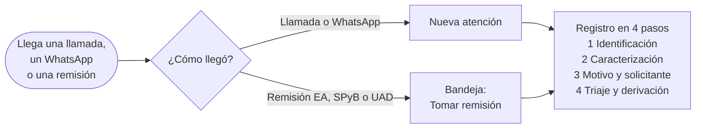

**Parte 2 — Del triaje al cierre**

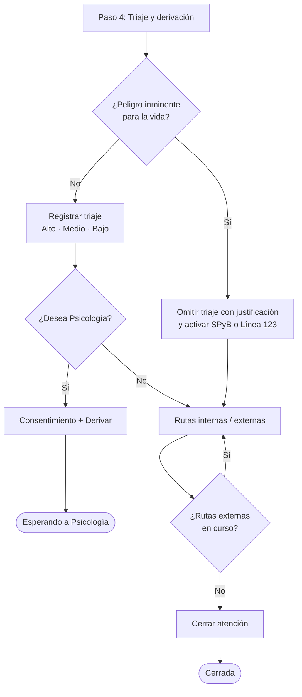

---

## 5. Estados de una atención

| Estado en pantalla | Qué significa |
|---|---|
| **Borrador** | Empezó a registrarla y guardó el progreso; aún falta completarla. |
| **Pendiente de tomar** | Es una remisión que nadie ha tomado. |
| **En gestión** | Una persona de APH la está atendiendo. |
| **Esperando a Psicología** | Se derivó; Psicología tiene un plazo para el primer contacto. |
| **Con caso abierto / En seguimiento** | Psicología ya abrió el caso. |
| **Cerrada** | Ya no se puede modificar. |

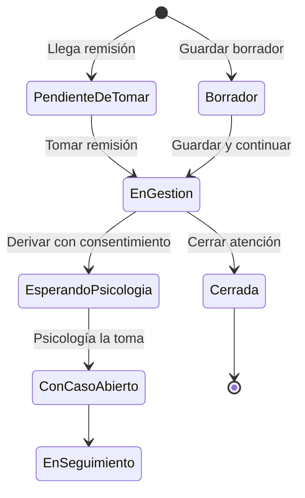

---

## 6. Flujo A — Registrar una llamada o mensaje nuevo

**Menú → Línea Alma → Nueva atención.** La pantalla es un formulario de **4 pasos**. Puede ir de un paso a otro con el selector superior o con los botones *Atrás* y *Guardar y continuar*.

> 💡 Puede **guardar un borrador en cualquier momento** y retomarlo después. Al guardar por primera vez aparece arriba el **código de la atención** (`ALMA-…`) con el botón *Copiar código*: anótelo si necesita volver a ella.

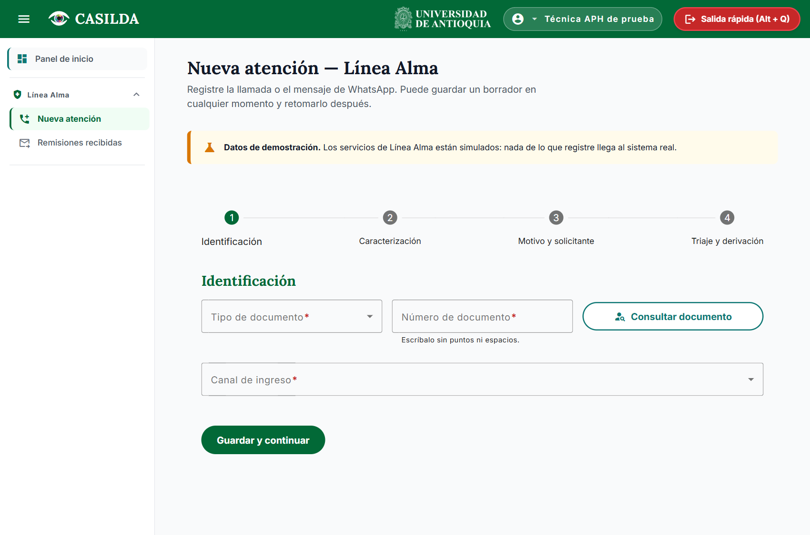

*Captura 2. Pantalla «Nueva atención», paso 1.*

### Paso 1 · Identificación

1. Elija el **Tipo de documento**.
2. Escriba el **Número de documento**, sin puntos ni espacios (solo acepta dígitos).
3. Pulse **Consultar documento** (o *Enter*). El sistema revisa si la persona ya tiene historial y puede mostrar:

| Resultado | Qué verá | Qué hacer |
|---|---|---|
| Sin historial | «No encontramos atenciones previas…» | Continúe normalmente. |
| Con historial | «La persona ya tiene historial en Línea Alma…» | La llamada se registra como **atención nueva**; no se vincula sola. |
| **Seguimiento psicológico activo** | Aviso con fecha del próximo seguimiento y profesional a cargo | Solo informativo. El sistema avisa a Psicología; **usted no vincula nada**. |
| **Caso cerrado** | Aviso con número de caso y fecha de cierre | Si la persona solo necesita contención, vea el [Flujo F](#11-flujo-f--contención-después-del-cierre). |

4. Elija el **Canal de ingreso** (llamada telefónica o WhatsApp). Si la atención llegó por remisión, el canal ya viene fijo.
5. Pulse **Guardar y continuar**.

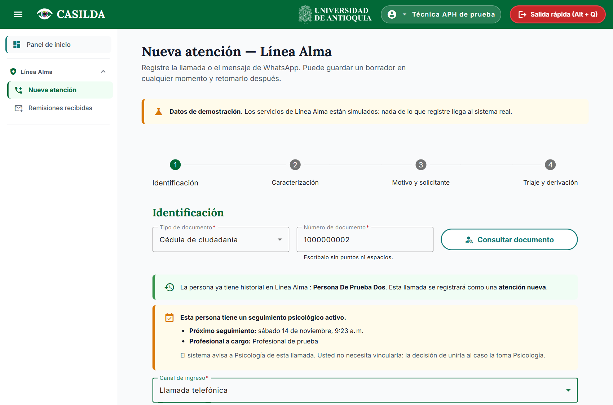

*Captura 3. Consulta con seguimiento activo.*

### Paso 2 · Caracterización

Todos los datos son **opcionales**: pregunte solo lo que la persona quiera compartir.

Campos: nombres, apellidos, teléfono principal (solo números), correo personal, ciudad de residencia y estrato.

### Paso 3 · Motivo y solicitante

- Si **quien llama es otra persona**, marque «Quien se comunica es otra persona, no la persona afectada». Aparecen nombres, apellidos, teléfono y relación con la persona afectada.
- **Motivo de consulta** (obligatorio): con las palabras de la persona, sin juicios.
- **Nota de valoración APH** (opcional): Psicología la verá como la nota de APH.

### Paso 4 · Triaje y derivación

Este paso se habilita cuando los pasos anteriores ya están guardados. Vea los flujos B, C y D.

> Si olvidó un campo obligatorio, aparece un **resumen de errores** en la parte superior con enlaces que llevan al campo.

---

## 7. Flujo B — Triaje

En el paso 4, seleccione **el nivel que le dio la herramienta de triaje**. Aquí no se calcula ni se sugiere nada.

| Nivel | Plazo máximo de primer contacto de Psicología |
|---|---|
| Alto | 12 horas |
| Medio | 24 horas |
| Bajo | 48 horas |

Pulse **Guardar triaje**.

### Si hay peligro inminente para la vida

1. Elija **«Peligro inminente para la vida»**. Esto permite **omitir el triaje**.
2. Escriba la **justificación** (mínimo 10 caracteres): la situación que obliga a actuar sin triaje.
3. Pulse **Registrar omisión del triaje**.
4. Aparece el panel **Rutas y derivaciones** para activar de inmediato a SPyB o a la Línea 123, **sin esperar el consentimiento**.

> Para derivar luego a Psicología deberá registrar el triaje después.

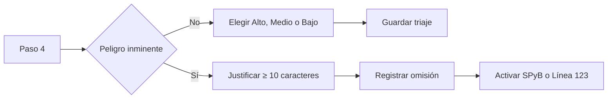

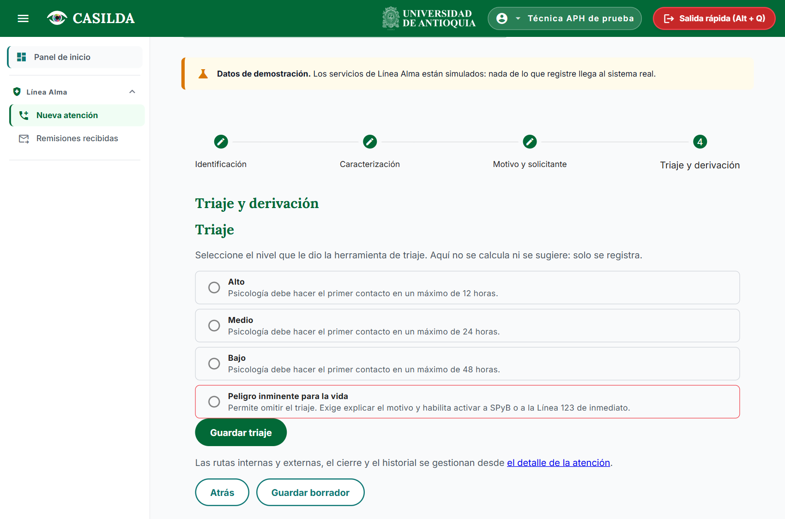

*Captura 4. Triaje con opción de peligro inminente.*

---

## 8. Flujo C — Remisión a Psicología

Después del triaje, responda **«¿La persona desea remisión a Psicología?»**

**Sí, desea atención psicológica**
1. Debe haber un **triaje registrado** (de él depende el plazo).
2. Lea el texto del **consentimiento informado** a la persona. Si la persona llama por teléfono, normalmente el medio es *verbal*; también existe *digital*.
3. Marque la casilla de aceptación. Se muestra «Consentimiento registrado…».
4. Pulse **Derivar a Psicología**. El botón solo se habilita con triaje y consentimiento.
5. Verá la confirmación: *«La atención ALMA-… quedó en la cola de Psicología»*, con el estado y la **fecha y hora límite del primer contacto**.

**No, por ahora no**
1. Pulse **Registrar que no desea remisión**.
2. La atención sigue **En gestión**; puede activar rutas (Flujo D) o cerrarla (Flujo G).

> Sin consentimiento **no hay derivación**. Si el texto del consentimiento no carga, la casilla queda deshabilitada: pulse *Intentar de nuevo*.

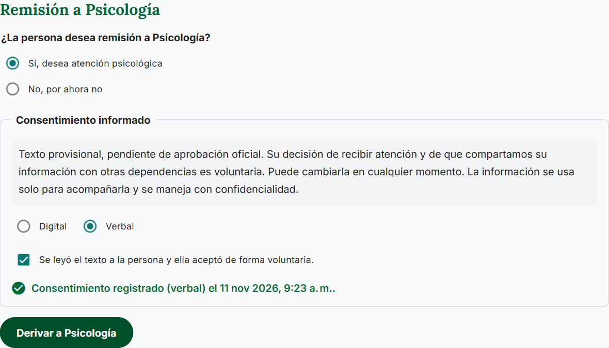

*Captura 5. Consentimiento y botón «Derivar a Psicología».*

---

## 9. Flujo D — Rutas internas y externas

Se gestionan en el bloque **Rutas y derivaciones** del **detalle de la atención** (y, en peligro inminente, también desde el paso 4).

### Derivar a una dependencia de la Universidad (ruta interna)
1. Pulse **Derivar a una dependencia**.
2. Elija la **dependencia** y escriba el **motivo** (solo lo necesario para que pueda actuar).
3. Si la dependencia lo admite, puede marcar **«Hay peligro inminente: activar sin esperar el consentimiento»**. En los demás casos se exige el consentimiento de la persona.
4. Pulse **Registrar derivación**. Queda en la lista como *Enviada*, *Recibida* o *Rechazada*.

### Activar una ruta externa
1. Pulse **Activar una ruta externa**.
2. Elija la **entidad**, la **fecha de activación** y el **motivo**; aplica la misma regla de consentimiento / peligro inminente.
3. Pulse **Registrar ruta**.
4. Para dar seguimiento use **Registrar seguimiento** en la ruta: actualice su **estado** y el **resultado**.

> Las rutas activadas con peligro inminente quedan marcadas con «Peligro inminente: se activó sin consentimiento previo».
> ⚠️ **Mientras haya rutas externas en curso no podrá cerrar la atención.**

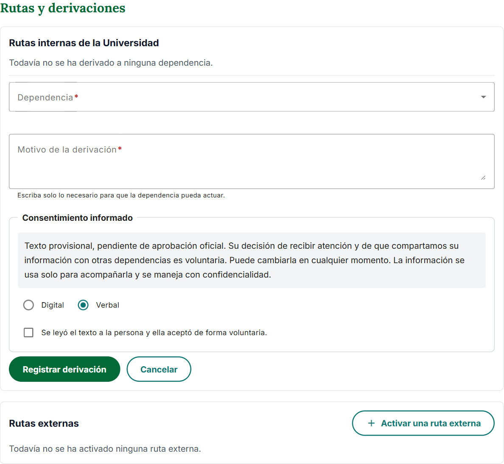

*Captura 6. Panel «Rutas y derivaciones».*

---

## 10. Flujo E — Remisiones recibidas (bandeja)

**Menú → Línea Alma → Remisiones recibidas.**

La pantalla tiene dos vistas:

| Vista | Qué muestra | Filtro |
|---|---|---|
| **Remisiones recibidas** | Solicitudes de Equipo de Atención, SPyB y UAD que esperan ser tomadas | Origen |
| **Mis atenciones** | Las atenciones que usted registró o tomó | Estado |

Cada fila muestra código, persona, origen o canal, fecha, resumen y estado. Si la atención está derivada, verá el **plazo del primer contacto** y, si ya pasó, «Plazo de primer contacto vencido».

**Para tomar una remisión**
1. En *Remisiones recibidas*, pulse **Tomar remisión** en la fila.
2. Se abre la atención para que complete el registro (Flujo A, desde el paso que falte).
3. Si otra persona la tomó antes, el sistema avisa del conflicto y recarga la lista. Es normal: elija otra.

**Para retomar un borrador:** en *Mis atenciones* pulse **Retomar**. Para solo consultar: **Ver detalle**.

Quien tiene rol de Revisión solo ve el botón **Ver**.

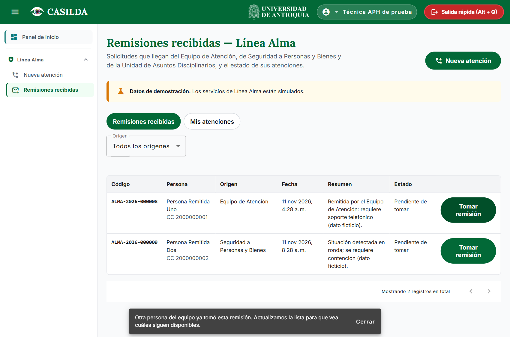

*Captura 9. Aviso cuando otra persona ya tomó la remisión.*

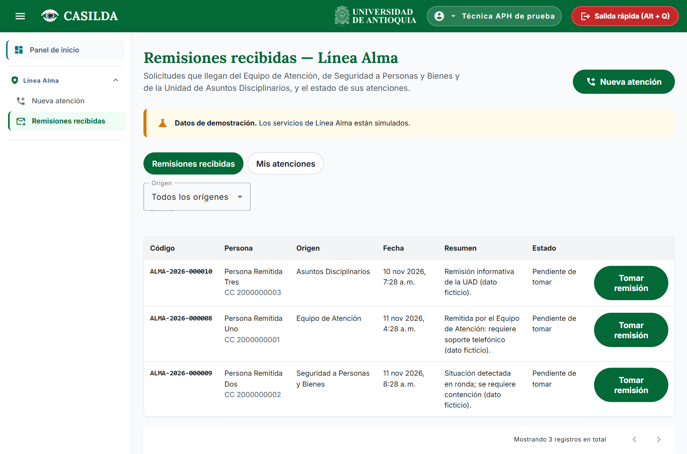

*Captura 7. Bandeja de remisiones.*

---

## 11. Flujo F — Contención después del cierre

Cuando una persona con **caso cerrado** vuelve a comunicarse solo para contención:

1. En el paso 1, consulte su documento. Aparece el aviso del caso cerrado.
2. Pulse **Registrar contención después del cierre** (o use el bloque que aparece en el paso 4 / detalle).
3. Escriba la **nota de contención** (mínimo 10 caracteres): qué se conversó y cómo quedó la persona.
4. Pulse **Registrar contención**.

> ℹ️ Esto **no reabre el caso y no suma seguimientos**. Queda en el historial como «después del cierre». Una llamada nueva siempre genera una atención `ALMA-…` nueva.

---

## 12. Flujo G — Detalle y cierre de una atención

Abra una atención desde la bandeja (*Ver detalle*) o desde el enlace «el detalle de la atención» del paso 4.

El detalle muestra, de arriba abajo:

1. **Encabezado:** código, persona y estado. *Continuar el registro* si puede editarla.
2. **Alertas:** gestión en simultáneo con el Equipo de Atención, y el plazo de primer contacto cuando espera a Psicología.
3. **Datos de la atención:** canal, origen, quién atiende, contacto y motivo.
4. **Triaje** (o la omisión y su justificación) y el consentimiento registrado.
5. **Notas de APH** en línea de tiempo.
6. **Rutas y derivaciones.**
7. **Cierre** (si corresponde).
8. **Historial de auditoría:** quién hizo qué y cuándo.

### Cerrar la atención
Aplica cuando la persona **no acepta Psicología** y **no quedan rutas externas en curso**.

1. En el bloque **Cerrar la atención**, elija el **Motivo de cierre**.
2. Escriba una **observación** si la necesita (opcional).
3. Pulse **Cerrar atención** y confirme el aviso: *«Después del cierre ya no se podrán modificar los datos de esta atención»*.

Si el botón está deshabilitado, lea el mensaje sobre el formulario: indica qué falta (por ejemplo, rutas externas por cerrar).

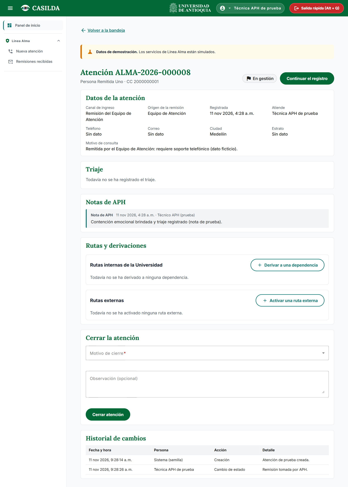

*Captura 8. Detalle de atención.*

---

## 13. Psicología — visión general

**Quién trabaja aquí:** Profesionales de Psicología (con Coordinación y Administración); Revisión consulta sin modificar. Hoy el acceso está habilitado solo para Administración.

**Menú → Línea Alma:**

- **Bandeja de Psicología** → `/linea-alma/psicologia/bandeja`
- **Recontactos** → `/linea-alma/psicologia/recontactos`
- **Mi agenda** → `/linea-alma/psicologia/agenda`

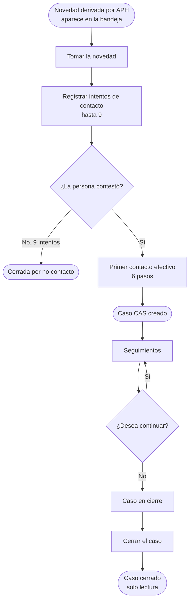

**Semáforo del plazo de primer contacto.** El plazo lo define el triaje de APH (Alto 12 h, Medio 24 h, Bajo 48 h) y el sistema lo mide con el reloj del servidor:

| Color | Significado |
|---|---|
| 🟢 **Dentro del plazo** | Queda más de la mitad del tiempo. |
| 🟡 **Plazo por vencer** | Queda entre el 50 % y el 20 %. |
| 🔴 **Plazo vencido o crítico** | Queda menos del 20 % o ya venció («Vencido hace 18 h»). |

> Los umbrales del semáforo son una propuesta pendiente de validar con el equipo. El color siempre va acompañado de un texto («Quedan 3 h 59 min»).

---

## 14. Flujo H — Bandeja de Psicología y toma de una novedad

**Menú → Línea Alma → Bandeja de Psicología.** Muestra las novedades derivadas por APH, ordenadas por el menor tiempo restante. La cola es **compartida** y se actualiza sola cada 30 segundos.

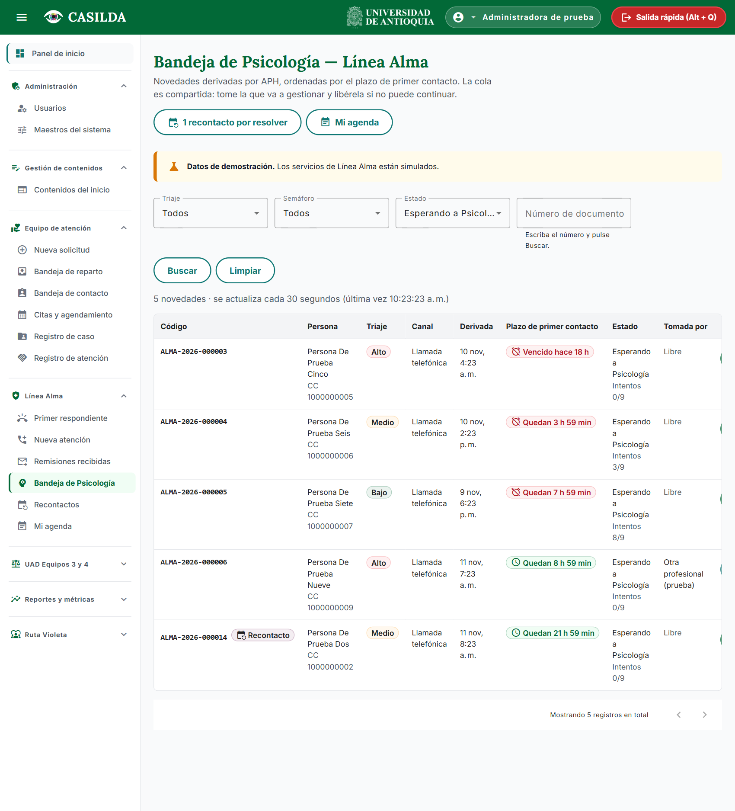

*Captura 10. Bandeja de Psicología.*

**Filtros:** triaje, semáforo, estado (por defecto, *Esperando a Psicología*) y número de documento. Pulse **Buscar** o **Limpiar**.

**Columnas:** código, persona, triaje, canal, fecha de derivación, plazo de primer contacto, estado con los intentos hechos («Intentos 3/9») y quién la tomó («Libre», «Usted» o el nombre de la profesional). Las novedades que corresponden a un recontacto llevan la etiqueta **Recontacto**.

**Atajos arriba:** *N recontactos por resolver* y *Mi agenda*.

**Para tomar una novedad**

1. Pulse **Tomar** en la fila (solo aparece si está libre).
2. Se abre la novedad. Verá «Tomó la novedad ALMA-…» y sus datos.
3. Si ya no puede continuar, pulse **Liberar** para devolverla a la cola.

Si otra profesional la tiene, el botón es **Ver**: puede consultarla, no editarla. Con una novedad suya, el botón es **Continuar**.

### La pantalla de la novedad

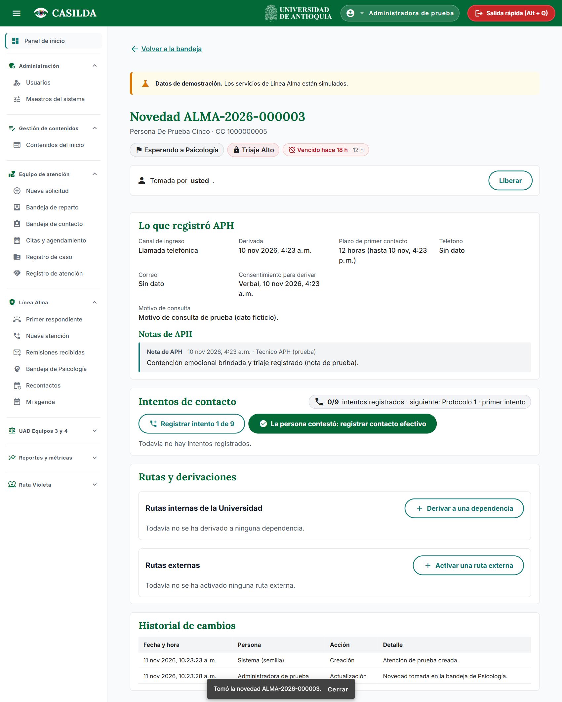

*Captura 11. Novedad con la toma, los datos de APH y los intentos de contacto.*

De arriba abajo:

1. **Encabezado:** estado, **triaje de APH** (con candado: no se puede editar), semáforo y etiqueta de recontacto.
2. **Toma:** quién la gestiona; botones *Tomar esta novedad* / *Liberar*.
3. **Alertas:** gestión en simultáneo con el Equipo de Atención; si la persona ya tiene un caso activo (el sistema **no** la vincula por su cuenta); o si la atención ya pertenece a un caso, con enlace al expediente.
4. **Lo que registró APH:** canal, origen, plazo, contacto, consentimiento para derivar, motivo de consulta y notas de APH.
5. **Intentos de contacto** (siguiente flujo) o, cuando la persona contestó, el **primer contacto efectivo**.
6. **Rutas y derivaciones previas** y el **historial de cambios**.

---

## 15. Flujo I — Intentos de contacto

Con la novedad **tomada por usted**, registre cada llamada que haga a la persona. El contador muestra «0/9 intentos» y cuál es el protocolo del siguiente.

| Intento | Protocolo |
|---|---|
| 1 | **Protocolo 1** · primer intento |
| 2 | **Protocolo 2** · distinto día u horario |
| 3 | **Protocolo 3** · nuevo día u horario |
| 4 al 9 | **Intento adicional**, con justificación obligatoria |

**Para registrar un intento**

1. Pulse **Registrar intento N de 9**.
2. Indique la **fecha y hora** del intento (no puede ser futura).
3. Elija el **resultado** (por ejemplo, *No contesta*, *Buzón de voz*, *Línea ocupada*, *Teléfono apagado o fuera de servicio*).
4. Escriba la **nota del intento**: es independiente de las anteriores.
5. Desde el 4.º intento aparece la **justificación del intento adicional**: explique por qué se hace uno más.
6. Pulse **Guardar intento**.

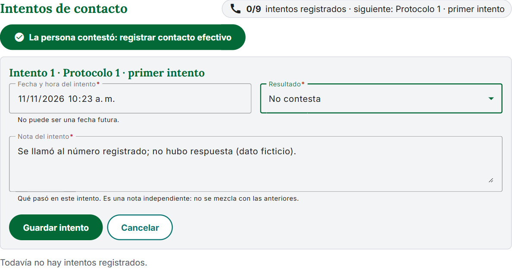

*Captura 12. Formulario de intento de contacto.*

> ⚠️ Si el intento se parece al anterior (mismo día o a menos de una hora de diferencia) aparece un **aviso amarillo**. Es solo una advertencia: puede continuar.
> ⚠️ El intento 9 muestra «Es el último intento del protocolo». Si no hay contacto, el sistema **cierra la novedad automáticamente por «No contacto»**.

Los intentos quedan en una lista, del más reciente al más antiguo, con protocolo, fecha, autora, resultado y nota.

Cuando la persona **contesta**, pulse **«La persona contestó: registrar contacto efectivo»** y siga el Flujo J.

---

## 16. Flujo J — Primer contacto efectivo y apertura del caso

Es un formulario de **6 pasos**. Puede **guardar un borrador** en cualquier paso (si vuelve, lo retoma y puede descartarlo) o **volver a los intentos**. Al terminar, el sistema genera el código del caso **CAS-AAAA-NNNNNN**.

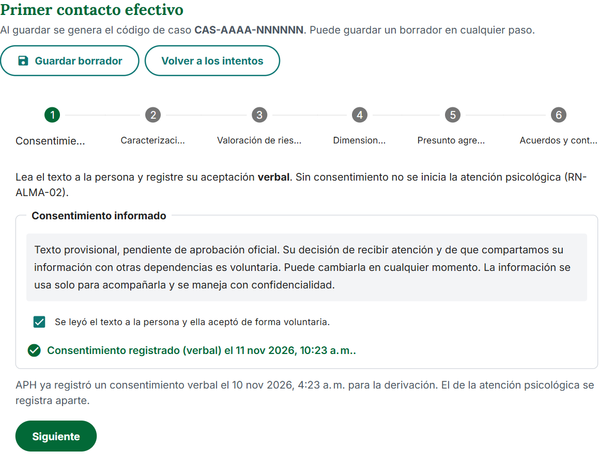

*Captura 13. Primer contacto efectivo — Paso 1, consentimiento.*

| Paso | Qué hacer |
|---|---|
| **1. Consentimiento** | Lea el texto a la persona y marque su aceptación **verbal**. Sin consentimiento no se inicia la atención psicológica. El que dio APH para derivar es aparte. |
| **2. Caracterización** | Complete o corrija lo que APH alcanzó a registrar (variables homologadas con el Equipo de Atención). |
| **3. Valoración de riesgo** | Elija el nivel de riesgo (**Alto, Medio o Bajo**) y escriba la **valoración clínica** (obligatoria, en lenguaje neutro). El triaje de APH se muestra con candado y **no se modifica**. |
| **4. Dimensiones** | Marque las dimensiones de salud mental que apliquen (hoy figuran como «Dimensión 1…15» hasta recibir el catálogo oficial). |
| **5. Presunto agresor** | Opcional: nombres, apellidos, vínculo, si conviven y observaciones. Ningún campo bloquea el guardado. |
| **6. Acuerdos y control** | Escriba los **acuerdos** con la persona y fije el **próximo control** (fecha y hora). Si la persona tiene un correo registrado, el sistema envía el recordatorio. |

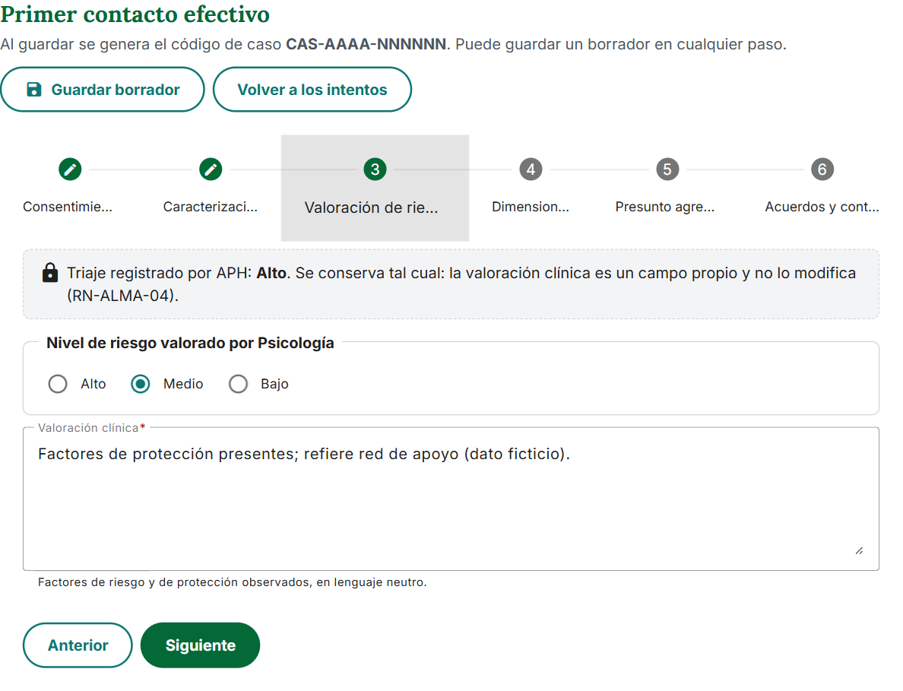

*Captura 14. Paso 3, valoración de riesgo.*

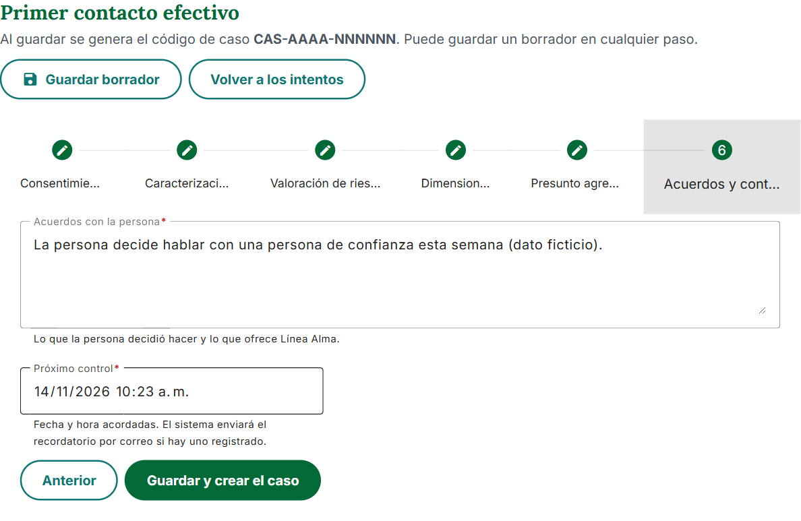

*Captura 15. Paso 6, acuerdos y próximo control.*

**Si la persona ya tiene un caso activo**, en el paso 6 debe decidir:

- **Vincular** esta atención al caso existente (mismos hechos), o
- **Abrir un caso nuevo** (hechos distintos).

Pulse **Guardar y crear el caso**. Se abre el expediente del caso nuevo.

---

## 17. Flujo K — Expediente y seguimientos

El expediente es la pantalla del caso (`/linea-alma/psicologia/casos/CAS-…`). También se llega desde la novedad, la agenda o el recontacto.

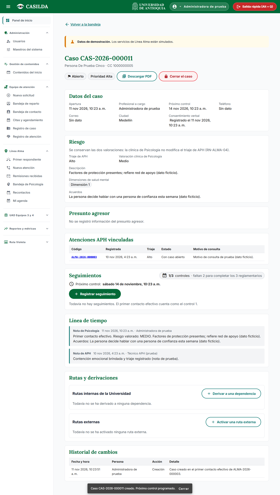

*Captura 16. Expediente del caso.*

**Encabezado:** estado del caso (Abierto, Activo, En cierre, Cerrado), **prioridad** (según el triaje: Alto → Alta, Medio → Media, Bajo → Baja) y, según su rol, **Descargar PDF** y **Cerrar el caso**.

**Bloques:** datos del caso (apertura, profesional a cargo, próximo control, consentimiento), **riesgo** (triaje de APH y valoración clínica, siempre las dos), presunto agresor, atenciones APH vinculadas, **seguimientos**, línea de tiempo, rutas y derivaciones, e historial de cambios.

### Registrar un seguimiento

El contador muestra «1/3 controles»: el **primer contacto efectivo cuenta como el control 1** y se esperan **3 reglamentarios** (puede haber más; el expediente sigue abierto).

1. Pulse **Registrar seguimiento**.
2. Escriba la **nota**: cómo está la persona, qué se trabajó y qué se acordó.
3. Responda **«¿La persona desea continuar con el seguimiento?»**:
   - **Sí** → indique el **próximo control** (fecha y hora). El sistema envía el recordatorio por correo si hay uno registrado.
   - **No** → al guardar se le ofrecerá **cerrar el caso**; mientras tanto queda **En cierre**. Si la persona vuelve a comunicarse, puede seguir registrando seguimientos.
4. Pulse **Guardar seguimiento**.

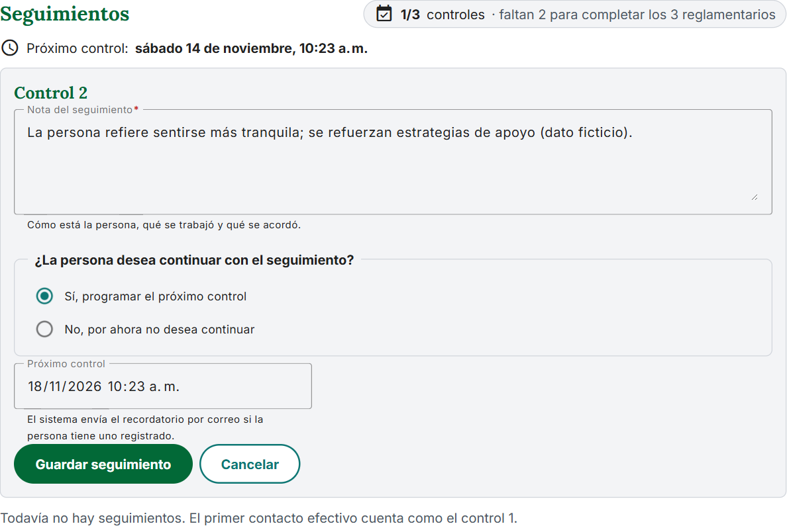

*Captura 17. Registro de un seguimiento.*

Cada seguimiento queda con número, fecha, autora, nota, próximo control y estado del recordatorio (enviado, fallido o sin correo).

---

## 18. Flujo L — Cierre del caso

Disponible para Profesionales y Administración, con el botón **Cerrar el caso** del expediente (o desde la oferta de cierre tras un seguimiento «No desea continuar»).

1. Elija el **motivo de cierre** (catálogo; obligatorio).
2. Escriba una **observación**. Es **obligatoria si el motivo es «Otro»**; en los demás casos es opcional.
3. Si su rol lo permite, marque **«Descargar el PDF del historial al cerrar»**.
4. Pulse **Cerrar el caso**.

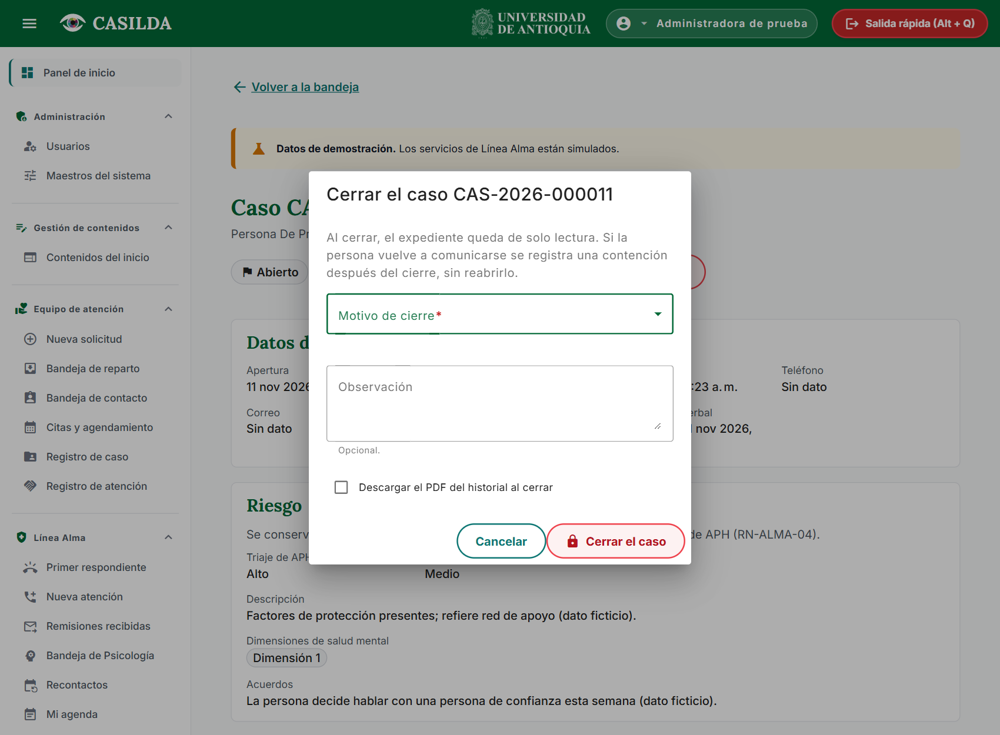

*Captura 18. Diálogo para cerrar el caso.*

> 🔒 Al cerrar, el expediente queda de **solo lectura**. Si la persona vuelve a comunicarse, **no se reabre**: se registra una *contención después del cierre* ([Flujo F](#11-flujo-f--contención-después-del-cierre)).

---

## 19. Flujo M — Agenda

**Menú → Línea Alma → Mi agenda.** Lista los **controles programados** de los casos activos.

1. Elija el rango **Desde / Hasta** y pulse **Consultar**.
2. Quien puede ver a todo el equipo elige el **alcance**: *Mis casos* o *Todo el equipo*.
3. Cada control muestra fecha y hora, persona, número de control (por ejemplo, «control 2/3»), profesional, estado del recordatorio y el botón **Abrir el caso**.

Las etiquetas **Hoy** y **Pendiente de registrar** (control que ya pasó sin seguimiento) ayudan a priorizar.

*Captura 19. Agenda de controles.*

---

## 20. Flujo N — Recontactos

**Menú → Línea Alma → Recontactos.** Reúne a las personas con un **caso activo** que volvieron a llamar a APH. Cada llamada genera una atención nueva y el sistema **nunca la vincula por su cuenta**: decide Psicología.

1. Elija un recontacto de la lista de la izquierda.
2. Compare, lado a lado, la **atención nueva** (fecha, canal, triaje, motivo, nota de APH) y el **caso activo** (apertura, estado, profesional, controles, próximo control, última nota). Use **Abrir el expediente** si necesita más contexto.
3. Elija qué hacer con la atención:

| Decisión | Qué ocurre |
|---|---|
| **Vincular al caso existente** | La atención pasa a formar parte del caso activo; sus notas de APH quedan en la línea de tiempo. |
| **Abrir un caso nuevo** (hechos distintos) | La novedad sigue en la bandeja y en el primer contacto efectivo se abre un caso nuevo. |
| **Contención puntual** (no suma seguimientos) | Se registra una contención sobre el caso activo y la nueva atención se cierra. |

4. Escriba la **nota de la decisión** (obligatoria; queda en el historial del caso y de la atención).
5. Pulse **Confirmar decisión** y confirme el aviso.

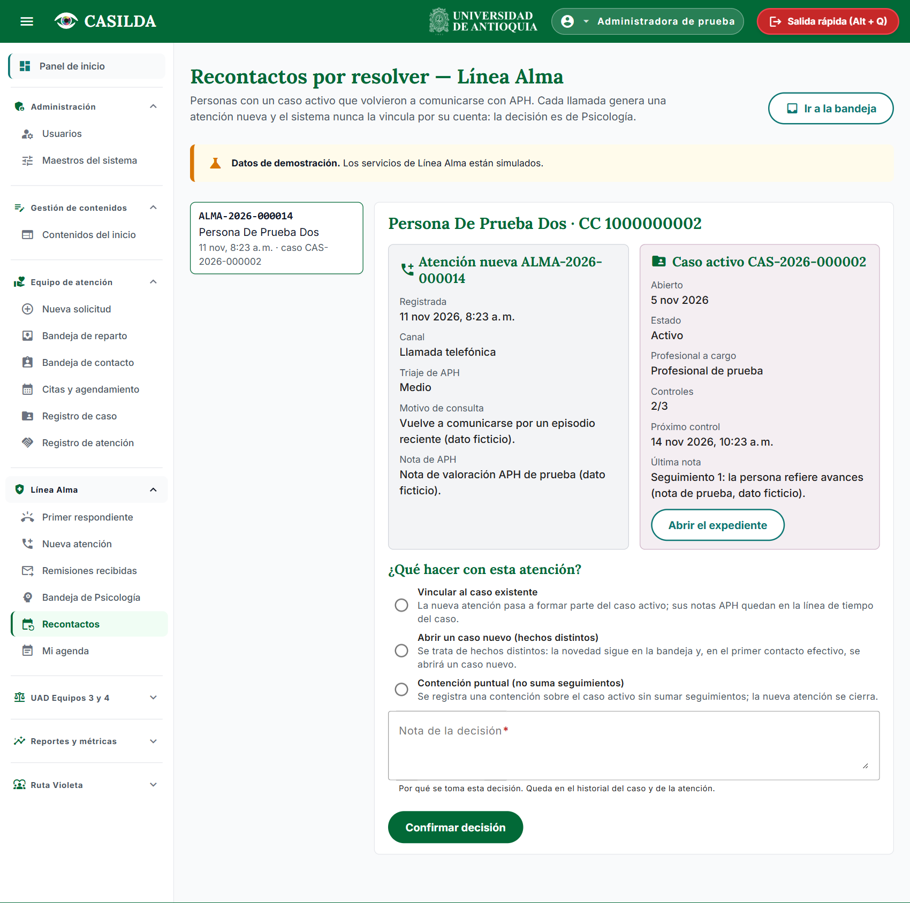

*Captura 20. Resolución de un recontacto.*

---

## 21. Mensajes frecuentes

| Mensaje | Qué significa | Qué hacer |
|---|---|---|
| «Seleccione el triaje o registre el peligro inminente para continuar» | Falta el triaje | Elija un nivel u omítalo con justificación. |
| «Falta registrar el consentimiento de la persona…» | La derivación exige consentimiento | Lea el texto y marque la casilla, o use peligro inminente si aplica. |
| «Para derivar a Psicología primero registre el triaje» | No hay triaje | Vuelva a *Guardar triaje*. |
| Conflicto al tomar o guardar | Otra persona modificó la atención | Se recarga con la versión más reciente; revise y repita. |
| «No pudimos cargar…» + *Intentar de nuevo* | Falla de red o del servidor | Reintente. Lo ya registrado no se pierde. |
| «Acceso denegado» | Su rol no tiene permiso (o Psicología aún no está habilitada para su rol) | Consulte con Coordinación. |
| «Tome la novedad para registrar intentos de contacto» | La novedad no es suya | Pulse **Tomar esta novedad**. |
| «La novedad ya no está pendiente: no se registran más intentos» | Ya hubo contacto efectivo o se cerró | Revise el estado de la novedad. |
| «Se agotaron los 9 intentos del protocolo» | No quedan intentos | La novedad se cerró por «No contacto». |
| «Otra profesional la está gestionando; puede consultarla, no editarla» | Otra persona tomó la novedad | Elija otra o pida que la libere. |
| Aviso amarillo de «distinto día u horario» | El intento se parece al anterior | Es una advertencia: puede continuar si así lo decide. |
| «La persona ya tiene un caso activo» | Recontacto de una persona con caso abierto | Decida si vincular o abrir un caso nuevo ([Flujo N](#20-flujo-n--recontactos)). |
| Al salir del formulario pregunta por cambios | Hay datos sin guardar | Guarde el borrador o confirme que quiere salir. |

---

## 22. Buenas prácticas

- **Guarde el borrador** si la llamada se corta o debe atender otra urgencia.
- Escriba el **motivo con las palabras de la persona**, sin juicios ni diagnósticos.
- Pida solo la **caracterización** que la persona quiera dar.
- **Nunca** use datos reales en el entorno de demostración.
- En Psicología, **libere** la novedad si no va a continuar, para que otra profesional pueda tomarla.
- Distinga los intentos de contacto: **otro día y otro horario** que el intento anterior.
- La valoración clínica y el triaje de APH son **dos datos distintos**: nunca se sobrescriben.
- Use **Salida rápida** (botón flotante, `Alt + Q` o doble `Esc`) si necesita cerrar la pantalla de inmediato por seguridad.

---

## 23. Cómo practicar con datos de demostración

Con el servidor simulado activo puede usar estas cédulas ficticias (tipo CC) en el paso 1:

| Documento | Escenario |
|---|---|
| `1000000002` | Seguimiento psicológico activo (próximo control en 3 días) |
| `1000000003` | Caso cerrado `CAS-2026-000003` (para practicar contención) |
| `1000000008` | Seguimiento psicológico activo (próximo control en 1 día) |
| `1000000004` a `1000000007`, `1000000009`, `1000000010` | Personas sin escenario especial |
| `2000000001` a `2000000003` | Remisiones de prueba que aparecen en la bandeja |

### Psicología (ingrese con una cuenta de Administración)

La bandeja de Psicología trae estas situaciones ficticias; los códigos `ALMA-…` los muestra la propia bandeja:

| Qué verá | Para practicar |
|---|---|
| Novedad de triaje **Alto** con plazo **vencido** (documento `1000000005`) | Semáforo rojo y toma de una novedad. |
| Novedad con **3 intentos** (`1000000006`) | El intento 4 exige justificación. |
| Novedad con **8 intentos** (`1000000007`) | El intento 9 cierra por «No contacto». |
| Novedad **ya tomada por otra profesional** | Modo solo consulta. |
| **Recontacto** de `1000000002` con el caso `CAS-2026-000002` activo | Resolver un recontacto (Flujo N). |
| Casos `CAS-2026-000002`, `…000003` (cerrado), `…000008` y `…000010` | Expediente, seguimientos, agenda y cierre. |

> Estas cuentas y datos existen solo con la configuración de desarrollo (`environment.lineaAlma.mocks`). **Nunca** se activan en un entorno desplegado.

---

## 24. Glosario

| Término | Significado |
|---|---|
| **APH** | Atención Psicológica Humanizada: primer respondiente de la línea. |
| **Atención** | Registro de una llamada, mensaje o remisión. Código `ALMA-AAAA-NNNNNN`. |
| **Triaje** | Nivel de prioridad (Alto, Medio, Bajo) dado por la herramienta de triaje. |
| **Primer contacto** | Primera comunicación de Psicología con la persona; tiene plazo según el triaje. |
| **Peligro inminente** | Riesgo para la vida que permite omitir el triaje y activar rutas sin consentimiento previo. |
| **Remisión** | Solicitud que llega de EA, SPyB o UAD. |
| **SPyB** | Seguridad a Personas y Bienes. |
| **UAD** | Unidad de Asuntos Disciplinarios. |
| **Novedad** | Atención derivada por APH que espera ser gestionada en la bandeja de Psicología. |
| **Semáforo de plazo** | Verde (queda más de la mitad del plazo), amarillo (entre el 50 % y el 20 %), rojo (menos del 20 % o vencido). |
| **Intento de contacto** | Cada llamada de Psicología para lograr el primer contacto; máximo 9. |
| **Contacto efectivo** | La persona contestó y acepta la atención psicológica; abre el caso. |
| **Caso (`CAS-AAAA-NNNNNN`)** | Expediente que Psicología abre en el primer contacto efectivo. |
| **Valoración clínica** | Nivel de riesgo (Alto, Medio, Bajo) que valora Psicología; no cambia el triaje de APH. |
| **Control / seguimiento** | Sesión de seguimiento del caso; el primer contacto cuenta como el control 1 y se esperan 3 reglamentarios. |
| **Recontacto** | Persona con caso activo que vuelve a llamar a APH; Psicología decide cómo tratarlo. |
| **Expediente** | Pantalla del caso con riesgo, seguimientos, línea de tiempo, rutas e historial. |
| **Contención post-cierre** | Nota de acompañamiento a una persona con caso cerrado; no reabre el caso. |

---
