# Manual de usuario — Línea Alma (APH y Psicología)

> **Para quién es:** Técnicos APH (primer respondiente), Profesionales de Psicología, Coordinación y Revisión que usan CASILDA para registrar y dar seguimiento a las llamadas y mensajes de la Línea Alma.
> **Versión:** 24 de noviembre de 2026 · **Alcance:** submódulo APH (`/linea-alma/aph/*`, secciones 6 a 8) y submódulo Psicología (`/linea-alma/psicologia/*`, secciones 9 a 15). Las pantallas se explican en el mismo orden del menú lateral.

> ⚠️ **Datos de demostración.** Mientras Backend no publique todos los servicios de Línea Alma, el módulo funciona con un servidor simulado y verá un aviso amarillo «Datos de demostración». **Nada de lo que registre llega al sistema real** y las personas que aparecen son ficticias.

> 🔎 **Cómo leer las capturas.** Los **círculos numerados** de color naranja señalan dónde actuar. Cada captura va seguida de una tabla con el mismo número que dice qué hacer en ese punto.

> ℹ️ **Campos que dependen del entorno.** Algunos datos nuevos (fecha de nacimiento, identidad de género, vínculo con la universidad, lugar de ocurrencia, evidencias, novedades y cierre de remisiones, y el bloque «Datos de la persona» de Psicología) solo se ven mientras funciona el servidor simulado. Cuando el entorno trabaja con el servicio real **no aparecen** hasta que Backend los habilite; el resto del manual no cambia.

---

## 1. Qué hace este módulo

Línea Alma recibe llamadas telefónicas y mensajes de WhatsApp de personas que necesitan contención o acompañamiento. Trabaja en dos etapas:

- **APH (primer respondiente):** atiende la llamada, registra, hace el triaje y, si la persona acepta, la deriva a Psicología.
- **Psicología:** recibe la derivación como una *novedad*, intenta el contacto, hace el primer contacto efectivo, abre el *caso* (`CAS-AAAA-NNNNNN`), hace los seguimientos y lo cierra.

El módulo APH sirve para:

1. **Registrar** cada llamada o mensaje como una *atención* con un código `ALMA-AAAA-NNNNNN`, directa o por un tercero.
2. **Registrar el triaje** (Alto, Medio, Bajo) que da la herramienta de triaje. El sistema no lo calcula: solo lo anota.
3. **Derivar a Psicología** cuando la persona lo desea y da su consentimiento.
4. **Agregar remisiones y rutas** internas (dependencias de la Universidad) y externas (entidades), también en caso de peligro inminente.
5. **Recibir remisiones** del Equipo de Atención, de Seguridad a Personas y Bienes (SPyB) y de la Unidad de Asuntos Disciplinarios (UAD).
6. **Cerrar** la atención o registrar **contención** cuando la persona vuelve a llamar después del cierre del caso.

El módulo de Psicología sirve para **gestionar la cola de novedades** (con semáforo de plazo), **registrar los intentos de contacto**, **abrir y seguir el caso**, **cerrarlo**, consultar la **agenda** de controles y resolver los **recontactos**.

> ⚠️ **Psicología: habilitación temporal.** Mientras el equipo define a qué roles se abre el submódulo, **hoy solo la Administración** ve y entra a las pantallas de Psicología. La matriz de permisos ya contempla a Coordinación, Profesionales y Revisión; cuando se habiliten verán exactamente lo que describe este manual.

> 🔒 **Privacidad.** El Técnico APH nunca ve notas clínicas ni exporta PDF. Solo ve la alerta informativa de seguimiento (sin contenido clínico). Escriba en las notas solo lo necesario. **Una llamada nueva siempre genera una atención nueva:** el sistema nunca vincula por su cuenta a la persona con un caso existente; esa decisión es de Psicología.

---

## 2. Quién puede hacer qué

| Acción | Técnico APH | Coordinación | Revisión | Profesional | Administración |
|---|:--:|:--:|:--:|:--:|:--:|
| Registrar una atención nueva | ✅ | ✅ | — | — | ✅ |
| Ver el detalle de una atención | ✅ | ✅ | ✅ | ✅ | ✅ |
| Editar / tomar remisiones | ✅ | ✅ | — | — | ✅ |
| Cerrar una atención | ✅ | — | — | — | ✅ |
| Ver la bandeja de remisiones (de **todas** las personas) | ✅ | ✅ | ✅ | — | ✅ |
| Ver la alerta de seguimiento | ✅ | ✅ | ✅ | ✅ | ✅ |
| **Psicología:** ver la bandeja, la agenda y las novedades | — | ✅ | ✅ | ✅ | ✅ |
| **Psicología:** tomar novedades, registrar intentos, primer contacto y seguimientos | — | ✅ | — | ✅ | ✅ |
| **Psicología:** cerrar un caso | — | — | — | ✅ | ✅ |
| **Psicología:** ver el expediente y los recontactos (notas clínicas) | — | ✅ | ✅ | ✅ | ✅ |
| **Psicología:** descargar el PDF del historial | — | ✅ | — | ✅ | ✅ |

El Técnico APH **nunca** ve notas clínicas, expedientes ni PDF. Las opciones que su rol no puede usar **no aparecen en el menú**; si abre una pantalla sin permiso, el sistema muestra «Acceso denegado». Por la habilitación temporal, las pantallas de Psicología solo se abren hoy con rol de Administración.

---

## 3. Cómo entrar

1. Inicie sesión en CASILDA con su cuenta institucional.
2. En el menú lateral busque la sección **Línea Alma**.
3. Al entrar a `/linea-alma/aph` se abre directamente *Registrar nueva atención*; al entrar a `/linea-alma/psicologia`, *Pendientes atención por psicología*.

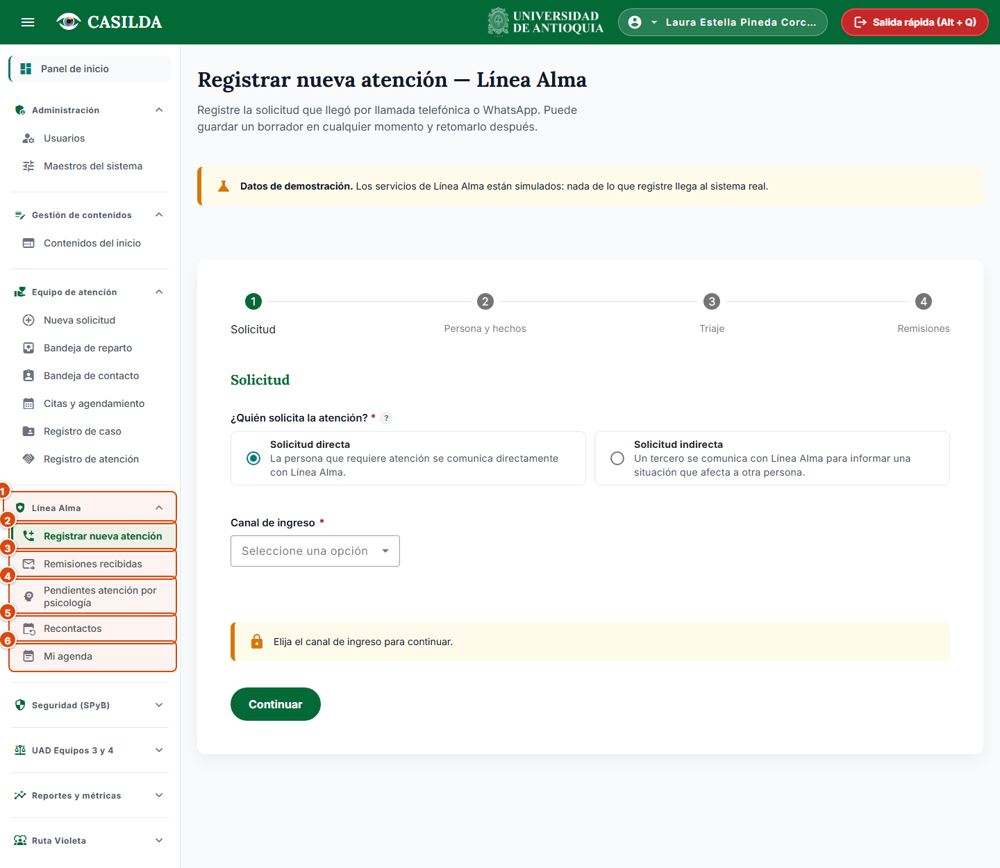

*Captura 1. Menú lateral con la sección Línea Alma.*

| # | Qué hacer |
|:--:|---|
| **1** | Abra o cierre la sección **Línea Alma** con un clic. |
| **2** | **Registrar nueva atención** (`/linea-alma/aph/nueva`): registro de una llamada o mensaje, en cuatro pasos. |
| **3** | **Remisiones recibidas** (`/linea-alma/aph/remisiones`): solicitudes que llegan de otras dependencias y sus atenciones. |
| **4** | **Pendientes atención por psicología** (`/linea-alma/psicologia/bandeja`): cola compartida de novedades. |
| **5** | **Recontactos** (`/linea-alma/psicologia/recontactos`): personas con caso activo que volvieron a llamar. |
| **6** | **Mi agenda** (`/linea-alma/psicologia/agenda`): controles programados. |

> Las opciones de Psicología (4 a 6) solo aparecen hoy con rol de Administración.

---

## 4. Mapa general del proceso

**Parte 1 — De la llegada al registro**

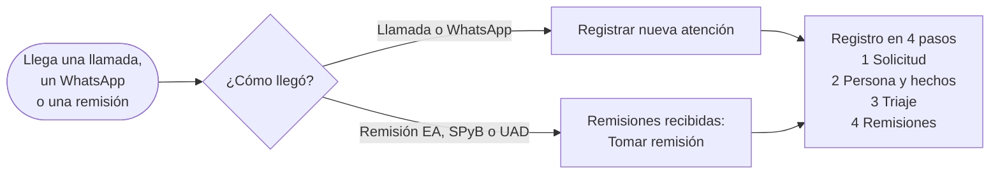

**Parte 2 — Del triaje al cierre**

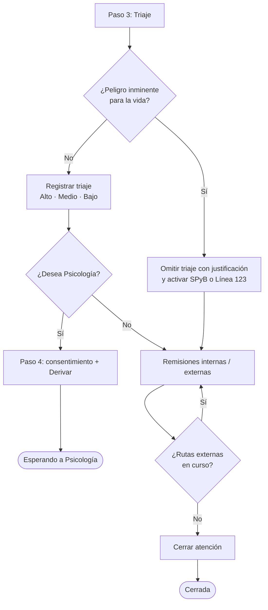

**Parte 3 — En Psicología**

---

## 5. Estados de una atención

| Estado en pantalla | Qué significa |
|---|---|
| **Borrador** | Empezó a registrarla y guardó el progreso; aún falta el triaje. |
| **Pendiente de tomar** | Es una remisión que nadie ha tomado. |
| **En gestión** | Una persona de APH la está atendiendo. |
| **Esperando a Psicología** | Se derivó; Psicología tiene un plazo para el primer contacto. |
| **Con caso abierto / En seguimiento** | Psicología ya abrió el caso. |
| **Cerrada** | Ya no se puede modificar. |

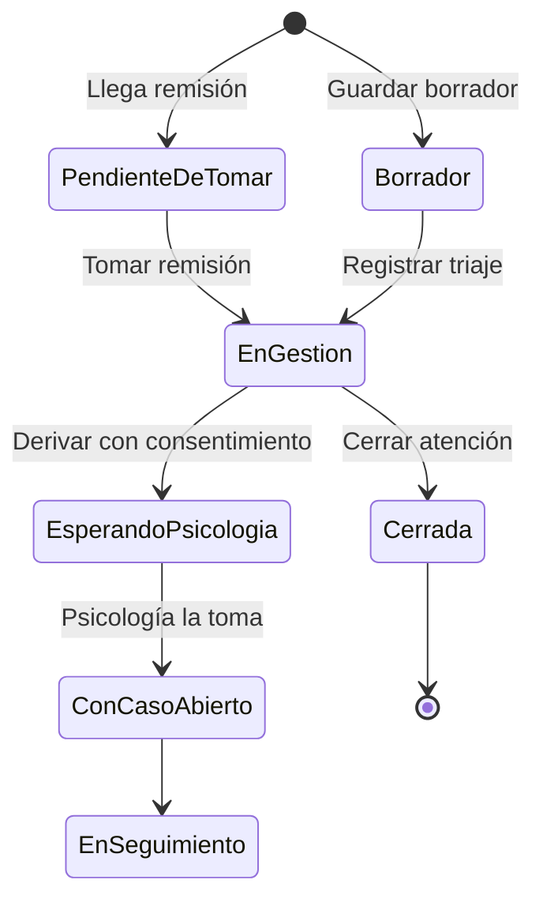

---

## 6. Registrar nueva atención

**Menú → Línea Alma → Registrar nueva atención.** La pantalla tiene **4 pasos**: **Solicitud**, **Persona y hechos**, **Triaje** y **Remisiones**. Cada paso se abre solo cuando el anterior está completo; si cambia algo de un paso anterior, los siguientes se vuelven a bloquear hasta guardar de nuevo.

> 💡 Puede **guardar un borrador en cualquier momento** y retomarlo después. Al guardar por primera vez aparece arriba el **código de la atención** (`ALMA-…`) con el botón *Copiar código*: anótelo si necesita volver a ella.

> 🔎 **Formularios.** Todos los formularios de Línea Alma se ven igual que los de Seguridad a personas y bienes: la etiqueta va arriba, un **asterisco rojo (\*)** marca lo obligatorio y el ícono **«?»** junto a la etiqueta —solo en los campos que pueden prestarse a confusión— abre una ayuda al pasar el cursor o enfocarlo. Los campos vacíos muestran un ejemplo («Ej: Juan») o «Seleccione una opción».

### 6.1. Paso 1 · Solicitud

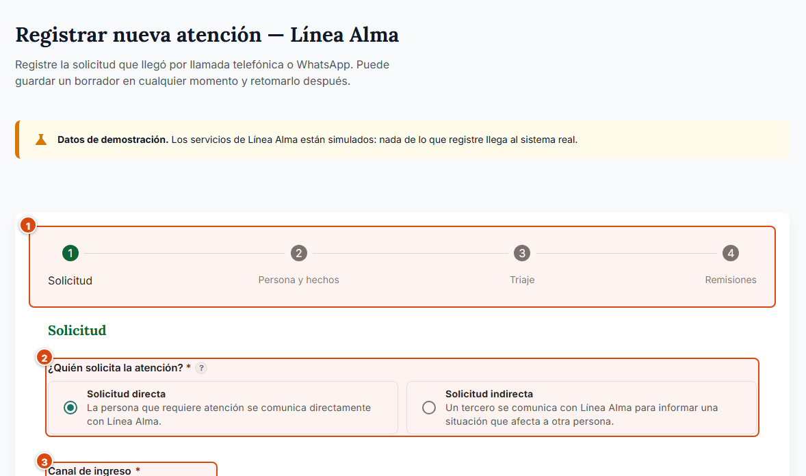

*Captura 2. Paso 1, solicitud directa.*

| # | Qué hacer |
|:--:|---|
| **1** | Los **cuatro pasos** del registro. Puede volver a uno anterior con un clic; los siguientes se abren a medida que completa. |
| **2** | **¿Quién solicita la atención?** *Directa*: la persona afectada se comunica con Línea Alma. *Indirecta*: un tercero informa la situación de otra persona. |
| **3** | **Canal de ingreso** (obligatorio): *WhatsApp* o *Telefónico*. Si la atención llegó por remisión, el canal ya viene fijo. |
| **4** | Pulse **Continuar**. Si falta el canal, un aviso lo indica y aparece el resumen de errores con un enlace al campo. |

Cuando la solicitud es **indirecta**, aparece el bloque **Información de quien realiza la solicitud**.

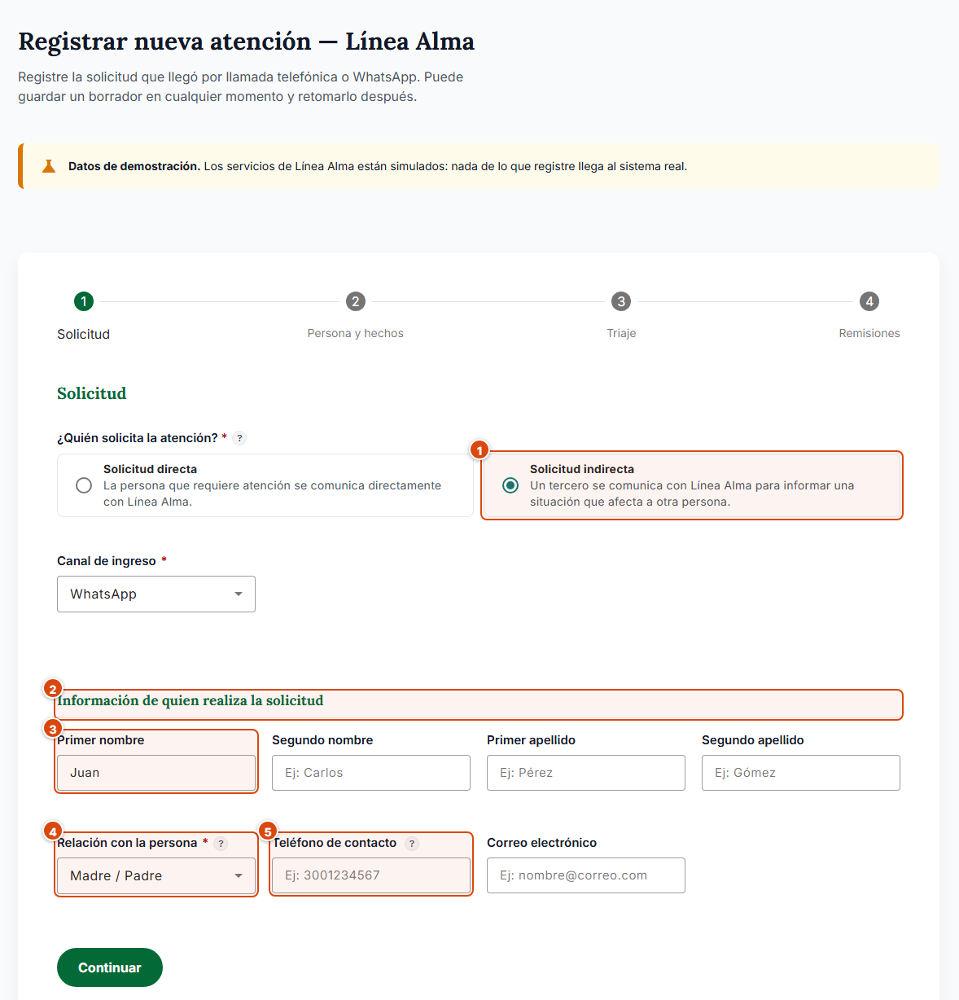

*Captura 3. Paso 1, solicitud indirecta.*

| # | Qué hacer |
|:--:|---|
| **1** | Elija **Solicitud indirecta**. |
| **2** | Aparece el bloque de **quien se comunica** (no es la persona afectada). |
| **3** | **Primer nombre, segundo nombre, primer apellido y segundo apellido** de quien llama. Solo letras; son opcionales. |
| **4** | **Relación con la persona** (obligatoria; 16 opciones). Si elige *Otro*, aparece **¿Cuál?** y también es obligatorio. |
| **5** | **Teléfono de contacto** (7 a 12 dígitos) y **correo electrónico**: son de quien solicita, no de la persona afectada, y son opcionales. |

### 6.2. Paso 2 · Persona y hechos

Aquí se identifica a la persona que requiere atención, se consulta si ya tiene historial y se registra lo ocurrido.

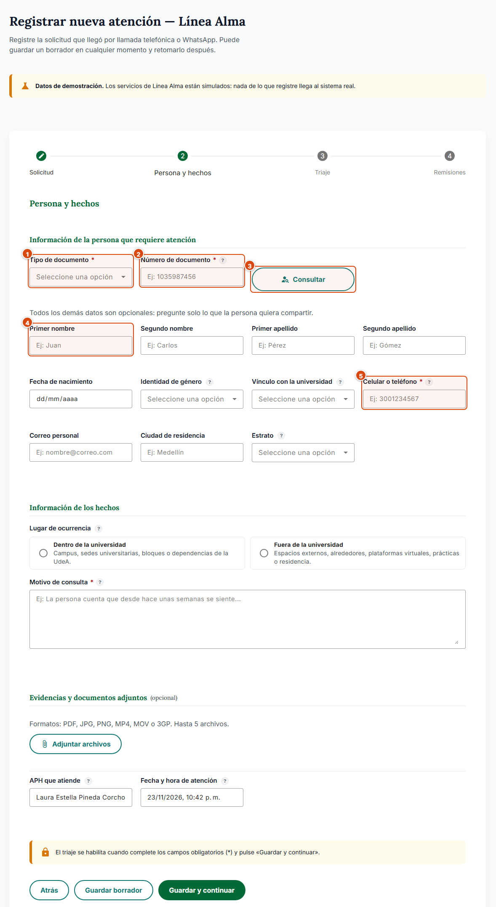

*Captura 4. Identificación y caracterización de la persona.*

| # | Qué hacer |
|:--:|---|
| **1** | **Tipo de documento** (obligatorio). |
| **2** | **Número de documento** (obligatorio), sin puntos ni espacios; solo acepta dígitos. Con *Enter* también consulta. |
| **3** | Pulse **Consultar**. El sistema revisa si la persona ya tiene historial (ver la tabla de abajo). |
| **4** | Datos de la persona: **primer y segundo nombre, primer y segundo apellido** (solo letras), fecha de nacimiento, identidad de género, vínculo con la universidad, correo personal, ciudad de residencia y estrato. **Pregunte solo lo que la persona quiera compartir.** |
| **5** | **Celular o teléfono** (7 a 12 dígitos): **es el único dato obligatorio** de la caracterización, para poder volver a contactar a la persona. |

| Resultado de la consulta | Qué verá | Qué hacer |
|---|---|---|
| Sin historial | «No encontramos atenciones previas…» | Continúe normalmente. |
| Con historial | «La persona ya tiene historial en Línea Alma…» | La llamada se registra como **atención nueva**; no se vincula sola. |
| **Seguimiento psicológico activo** | Aviso con fecha del próximo seguimiento y profesional a cargo | Solo informativo. El sistema avisa a Psicología; **usted no vincula nada**. |
| **Caso cerrado** | Aviso con número de caso y fecha de cierre | Si la persona solo necesita contención, vea la [sección 8.3](#83-contención-después-del-cierre). |

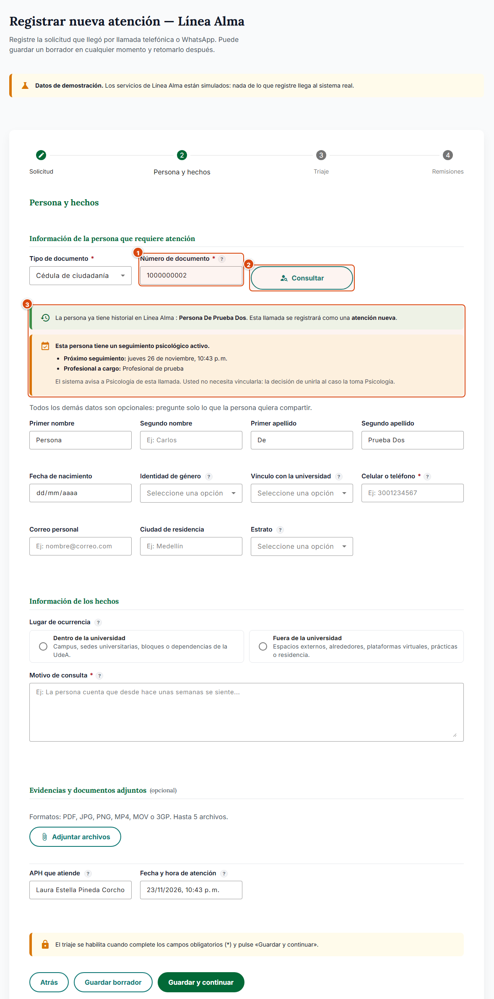

*Captura 5. Consulta de una persona con seguimiento psicológico activo.*

| # | Qué hacer |
|:--:|---|
| **1** | Escriba el documento `1000000002` (dato de demostración). |
| **2** | Pulse **Consultar**. |
| **3** | Lea el aviso: informa el próximo seguimiento y la profesional a cargo. **No hay nada que vincular.** |

Siga con **Información de los hechos**, **evidencias** y los datos que asigna el sistema.

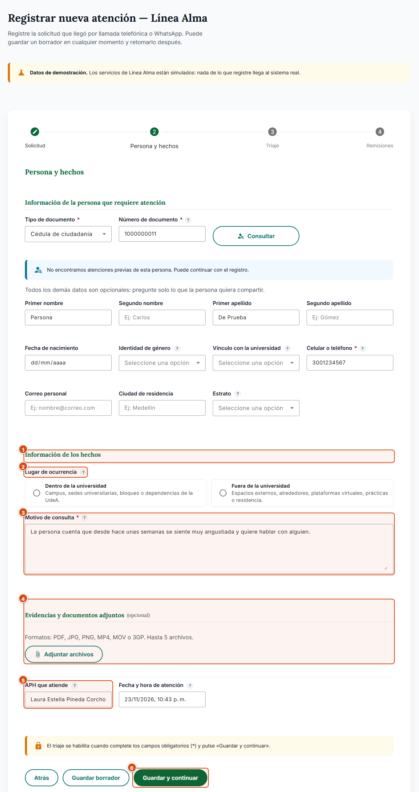

*Captura 6. Información de los hechos, evidencias y datos del sistema.*

| # | Qué hacer |
|:--:|---|
| **1** | **Información de los hechos.** |
| **2** | **Lugar de ocurrencia** (opcional): dentro o fuera de la Universidad. |
| **3** | **Motivo de consulta** (obligatorio): con las palabras de la persona, sin juicios. |
| **4** | **Evidencias** (opcional): hasta **5 archivos** (PDF, JPG, PNG, MP4, MOV o 3GP), de máximo 10 MB cada uno y 25 MB en total. Cada archivo se puede quitar con su botón; se suben al guardar. |
| **5** | **APH que atiende** y **Fecha y hora de atención**: los asigna el sistema, no se escriben. |
| **6** | Pulse **Guardar y continuar**. Se guarda el borrador y se abre el triaje. |

> En esta etapa **no se registra al presunto agresor**: ese dato lo toma Psicología en el primer contacto.

> Si olvidó un campo obligatorio, aparece un **resumen de errores** en la parte superior con enlaces que llevan al campo.

### 6.3. Paso 3 · Triaje

Se habilita cuando el paso 2 está completo y guardado. Seleccione **el nivel que le dio la herramienta de triaje**; aquí no se calcula ni se sugiere nada.

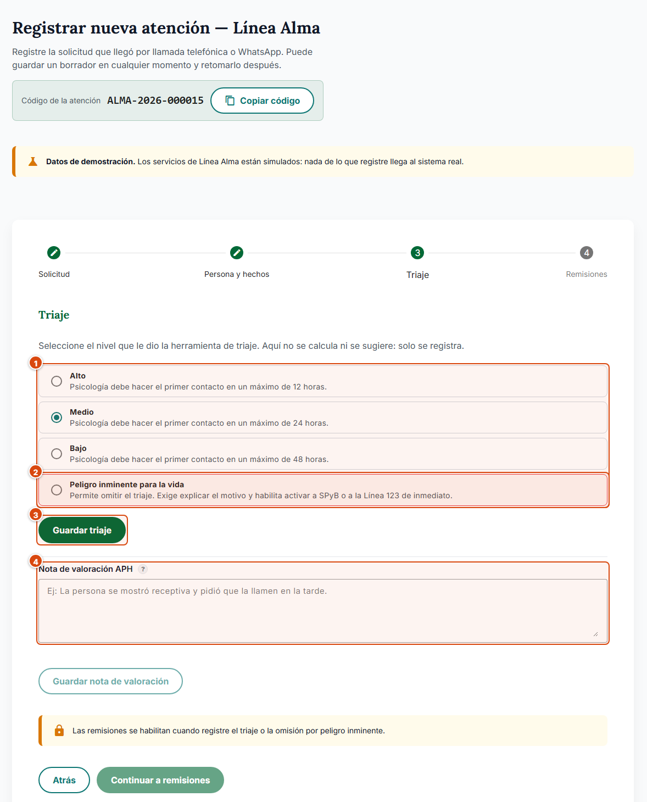

*Captura 7. Triaje y nota de valoración APH.*

| # | Qué hacer |
|:--:|---|
| **1** | Elija **Alto**, **Medio** o **Bajo**. De él depende el plazo de primer contacto de Psicología. |
| **2** | **Peligro inminente para la vida:** permite omitir el triaje (ver abajo). |
| **3** | Pulse **Guardar triaje**. |
| **4** | **Nota de valoración APH** (opcional): Psicología la verá como la nota de APH. Tiene su propio botón de guardado. |

| Nivel | Plazo máximo de primer contacto de Psicología |
|---|---|
| Alto | 12 horas |
| Medio | 24 horas |
| Bajo | 48 horas |

**Si hay peligro inminente para la vida**, elija esa opción, escriba la **justificación** (mínimo 10 caracteres: la situación que obliga a actuar sin triaje) y pulse **Registrar omisión del triaje**. Podrá activar de inmediato a SPyB o a las líneas 123 **sin esperar el consentimiento**. Para derivar luego a Psicología deberá registrar el triaje.

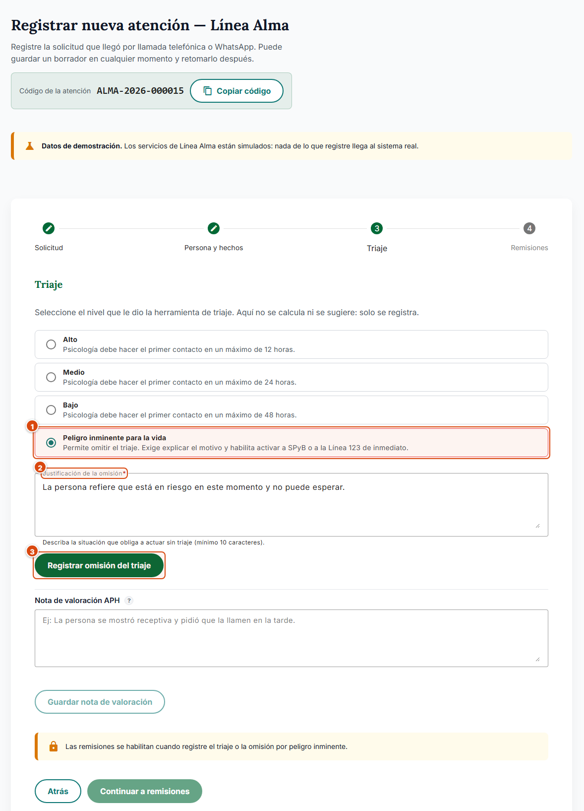

*Captura 8. Triaje omitido por peligro inminente.*

| # | Qué hacer |
|:--:|---|
| **1** | Elija **Peligro inminente para la vida**. |
| **2** | Escriba la **justificación** de la omisión. |
| **3** | Pulse **Registrar omisión del triaje**. |

Cuando el triaje o la omisión queden registrados, pulse **Continuar a remisiones**.

### 6.4. Paso 4 · Remisiones

Reúne la remisión a Psicología y las remisiones y rutas internas y externas.

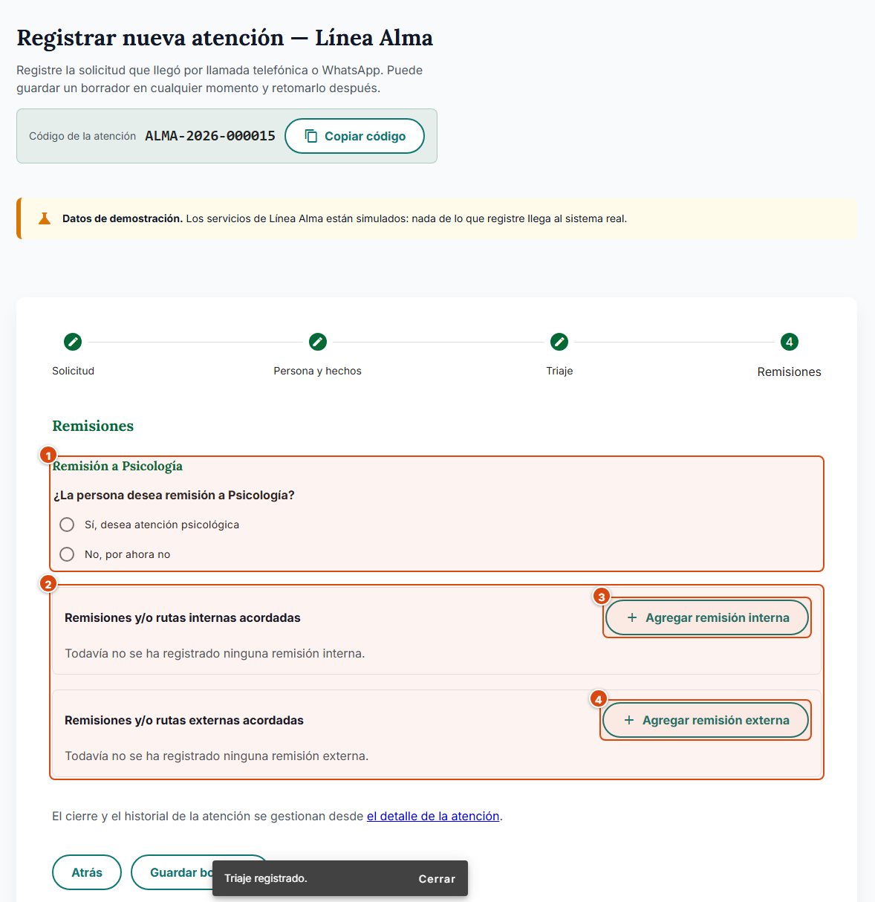

*Captura 9. Paso 4, Remisiones.*

| # | Qué hacer |
|:--:|---|
| **1** | **Remisión a Psicología:** responda si la persona desea atención psicológica. |
| **2** | **Remisiones y/o rutas** internas y externas acordadas. |
| **3** | **Agregar remisión interna** (dependencias de la Universidad). |
| **4** | **Agregar remisión externa** (entidades). |

**Remisión a Psicología.** Después del triaje, responda **«¿La persona desea remisión a Psicología?»**

- **Sí, desea atención psicológica:** debe haber un triaje registrado (de él depende el plazo). Lea el **consentimiento informado** a la persona (si llama por teléfono, normalmente es *verbal*), marque la casilla y pulse **Derivar a Psicología**. Verá la confirmación con el estado y la **fecha y hora límite del primer contacto**.
- **No, por ahora no:** pulse **Registrar que no desea remisión**. La atención sigue *En gestión*; puede agregar remisiones o cerrarla.

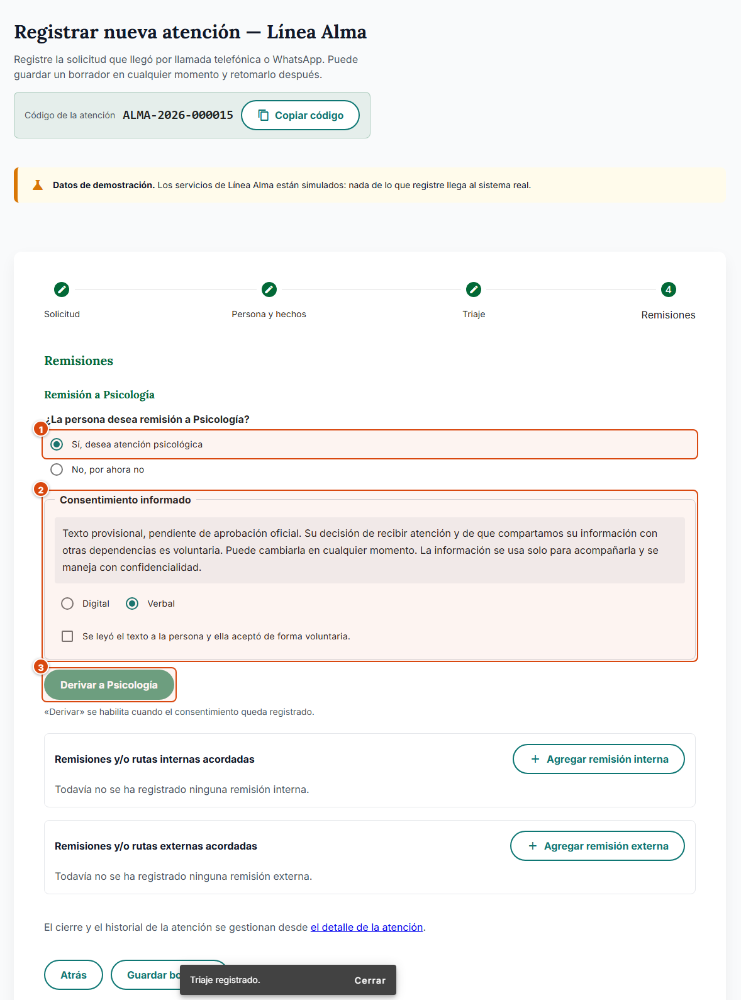

*Captura 10. Consentimiento y botón «Derivar a Psicología».*

| # | Qué hacer |
|:--:|---|
| **1** | Elija **Sí, desea atención psicológica**. |
| **2** | Lea el texto del **consentimiento** y marque que se leyó y la persona aceptó de forma voluntaria. |
| **3** | Pulse **Derivar a Psicología**. El botón solo se habilita con triaje y consentimiento. |

> Sin consentimiento **no hay derivación**. Si el texto del consentimiento no carga, la casilla queda deshabilitada: pulse *Intentar de nuevo*.

**Remisiones internas.** APH ofrece tres instancias: **SPyB**, **Masculinidades** y **Bienestar de la facultad**; Psicología ve la lista completa. Debajo del campo se indica qué módulo recibe la remisión (Equipo de Atención, SPyB o UAD).

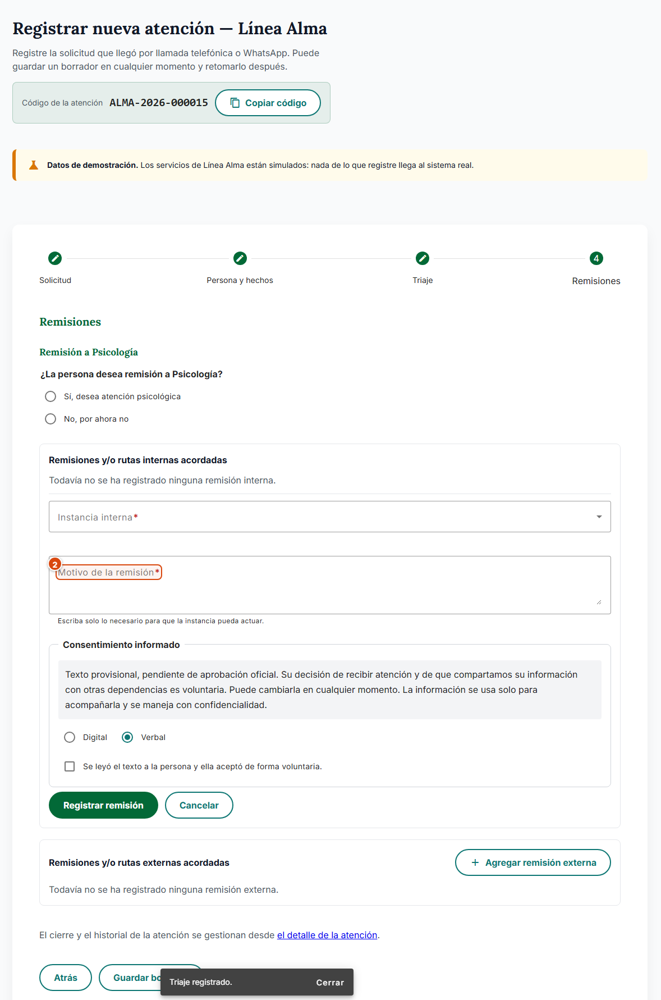

*Captura 11. Agregar una remisión interna.*

| # | Qué hacer |
|:--:|---|
| **1** | Elija la **instancia interna**. |
| **2** | Escriba el **motivo**: solo lo necesario para que la instancia pueda actuar. |
| **3** | Pulse **Registrar derivación**. Queda en la lista como *Enviada*, *Recibida*, *Rechazada* o *Cerrada*. |

La regla de consentimiento es la misma de la remisión a Psicología; solo si hay **peligro inminente** y la instancia lo admite puede marcar **«activar sin esperar el consentimiento»**, y la remisión queda marcada así.

**Remisiones externas.** Pulse **Agregar remisión externa**, elija la **entidad** (Comisaría de Familia, Fiscalía, Inspección de Policía, Procuraduría, Ruta de salud u Otra), indique la **fecha de activación** y el **motivo** y pulse **Registrar ruta**.

**«No acepta» y «No aplica».** Estas opciones solo dejan constancia: **no piden consentimiento ni motivo** y no llegan a ninguna bandeja.

**Novedades y cierre de cada remisión.** Cada remisión admite **varias novedades** con fecha y hora, útiles cuando vuelve a comunicarse con la persona y esta le cuenta cómo va el trámite: pulse **Agregar novedad**, escriba la novedad (entre 5 y 500 caracteres) y la fecha y hora en que la supo (no puede ser futura). En las rutas externas use **Actualizar estado** para marcarla *En seguimiento* o *Cerrada* con su resultado; en una remisión interna, **Cerrar derivación** con el resultado.

> ℹ️ **Remitir o cerrar una remisión no cierra la atención.** La atención sigue *En gestión*; se cierra aparte ([sección 8.2](#82-cerrar-la-atención)). ⚠️ **Mientras haya rutas externas en curso no podrá cerrar la atención.**

### 6.5. Casos de uso: para qué sirve cada función

| Caso de uso | Situación | Qué hace APH | Qué pasa después |
|---|---|---|---|
| **La persona llama y quiere ayuda** | Una estudiante llama angustiada y acepta hablar con Psicología. | Registra la solicitud directa, completa la persona y los hechos, registra el triaje y deriva con consentimiento verbal. | La atención pasa a *Esperando a Psicología* con un plazo según el triaje. |
| **Llama un familiar** | La madre de una estudiante llama preocupada por su hija. | En el paso 1 elige *Solicitud indirecta*, escribe los datos de la madre y la relación; en el paso 2, los de la estudiante. | La atención queda a nombre de la estudiante; los datos de la madre quedan como «quien se comunica». |
| **La persona ya tiene un caso** | Quien llama ya tiene seguimiento activo con Psicología. | Consulta el documento y lee el aviso; registra la llamada como atención nueva. | Psicología recibe un *recontacto* y decide si vincula, abre un caso nuevo o registra una contención puntual. |
| **Hay peligro inminente** | La persona refiere que está en riesgo ahora. | Elige *Peligro inminente*, justifica la omisión del triaje y agrega una remisión a SPyB o a la línea 123 sin esperar el consentimiento. | La remisión queda marcada como activada sin consentimiento previo. |
| **La persona no quiere Psicología** | Llama, pero solo quiere desahogarse. | Registra el triaje, responde que no desea remisión y, si hace falta, agrega remisiones; luego cierra la atención. | La atención se cierra **sin número de caso**: el caso solo se crea cuando Psicología atiende. |
| **Hay que avisar a otra dependencia** | La situación requiere que SPyB o la UAD la conozcan. | En el paso 4 agrega una remisión interna con motivo y consentimiento. | Llega a la bandeja del módulo que corresponde. |
| **Seguimiento de una remisión** | Dos días después la persona vuelve a llamar y cuenta cómo va el trámite. | En la remisión pulsa *Agregar novedad* con la fecha y hora en que lo supo. | Queda en el historial de esa remisión; la atención sigue abierta. |

### 6.6. Salir sin guardar

Si escribió datos y intenta salir de la pantalla (por ejemplo, con el menú), el sistema pregunta antes de perder lo escrito.

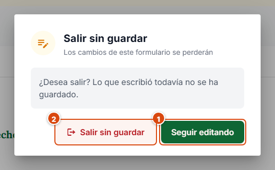

*Captura 28. Aviso al salir de un formulario con cambios sin guardar.*

| # | Qué hacer |
|:--:|---|
| **1** | **Seguir editando:** vuelve al formulario sin perder nada. Es la opción destacada. |
| **2** | **Salir sin guardar:** abandona la pantalla y se pierde lo que no guardó como borrador. |

> La **Salida rápida** (botón flotante, `Alt + Q` o doble `Esc`) no pasa por este aviso: cierra la pantalla de inmediato por seguridad.

---

## 7. Remisiones recibidas (bandeja)

**Menú → Línea Alma → Remisiones recibidas.**

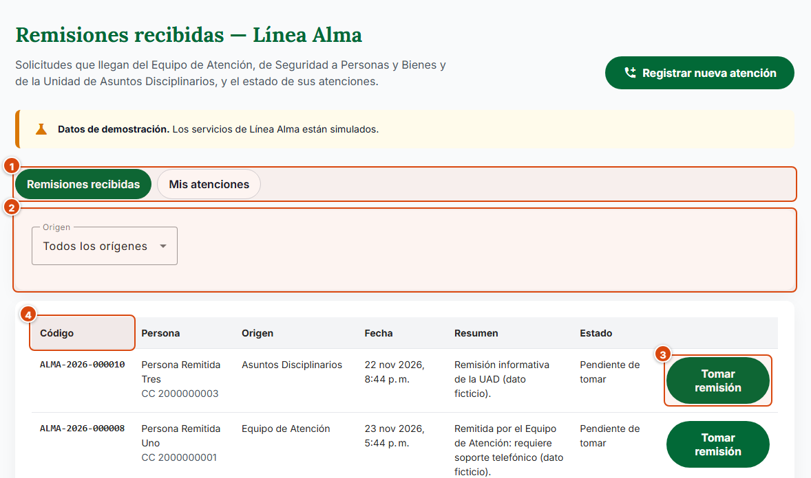

*Captura 12. Bandeja de remisiones.*

| # | Qué hacer |
|:--:|---|
| **1** | Cambie entre **Remisiones recibidas** (solicitudes de Equipo de Atención, SPyB y UAD que esperan ser tomadas) y **Mis atenciones** (las que usted registró o tomó). |
| **2** | Filtre por **origen** (remisiones) o por **estado** (mis atenciones). |
| **3** | Pulse **Tomar remisión** en la fila. |
| **4** | Cada fila muestra código, persona, origen o canal, fecha, resumen y estado; si está derivada, el **plazo del primer contacto**. |

**Tomar una remisión.** Se abre **la misma pantalla de «Registrar nueva atención»**, con todos los campos, para que complete el registro. **APH que atiende** y **Fecha y hora de atención** vienen asignadas. Si la remisión ya trae triaje, se abre en el paso 3. Si otra persona la tomó antes, el sistema avisa del conflicto y recarga la lista; elija otra.

**Retomar un borrador:** en *Mis atenciones* pulse **Retomar**. Para solo consultar: **Ver detalle**.

> **Cualquier perfil APH ve todas las remisiones recibidas**, no solo las propias; así se puede cubrir el cambio de turno. Quien tiene rol de Revisión solo ve el botón **Ver**.

---

## 8. Detalle y cierre de una atención

### 8.1. El detalle

Abra una atención desde la bandeja (*Ver detalle*) o desde el enlace «el detalle de la atención» del paso 4.

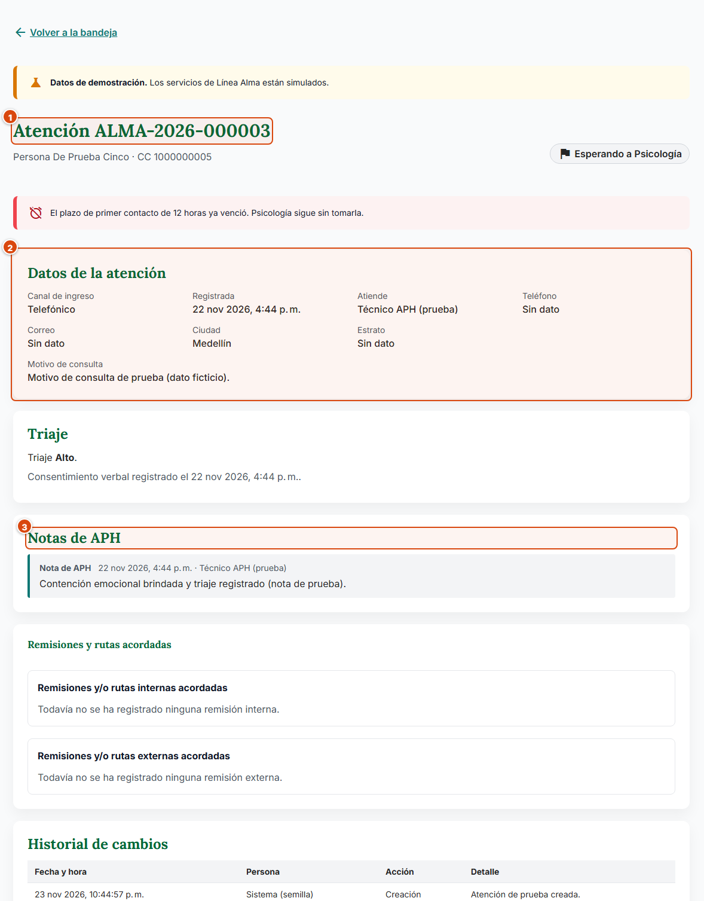

*Captura 13. Detalle de una atención.*

| # | Qué hacer |
|:--:|---|
| **1** | **Encabezado:** código, persona y estado. *Continuar el registro* si puede editarla. |
| **2** | Bloques, de arriba abajo: alertas (gestión en simultáneo con el Equipo de Atención y plazo de primer contacto), datos de la atención (canal, origen, quién atiende, quién solicita, contacto y motivo), triaje y consentimiento, notas de APH, remisiones y rutas, y cierre. |
| **3** | **Historial de auditoría:** quién hizo qué y cuándo. |

### 8.2. Cerrar la atención

Aplica cuando la persona **no acepta Psicología** (rechaza la remisión) y **no quedan rutas externas en curso**.

1. En el bloque **Cerrar la atención**, elija el **Motivo de cierre**.
2. Escriba una **observación** si la necesita (opcional, hasta 1000 caracteres).
3. Pulse **Cerrar atención** y confirme el aviso: *«Después del cierre ya no se podrán modificar los datos de esta atención»*.

Si el botón está deshabilitado, lea el mensaje sobre el formulario: indica qué falta (por ejemplo, rutas externas por cerrar).

> ℹ️ **Cerrar una atención no genera número de caso (`CAS-…`).** El caso solo se crea cuando Psicología atiende a la persona. Una misma persona puede tener varias atenciones a lo largo del tiempo y recibir contención continua.

### 8.3. Contención después del cierre

Cuando una persona con **caso cerrado** vuelve a comunicarse solo para contención:

1. En el paso 2 del registro, consulte su documento. Aparece el aviso del caso cerrado.
2. Pulse **Registrar contención después del cierre**.
3. Escriba la **nota de contención** (mínimo 10 caracteres): qué se conversó y cómo quedó la persona.
4. Pulse **Registrar contención**.

> ℹ️ Esto **no reabre el caso y no suma seguimientos**. Queda en el historial como «después del cierre». Una llamada nueva siempre genera una atención `ALMA-…` nueva.

---

## 9. Psicología — visión general

**Quién trabaja aquí:** Profesionales de Psicología (con Coordinación y Administración); Revisión consulta sin modificar. Hoy el acceso está habilitado solo para Administración.

**Semáforo del plazo de primer contacto.** El plazo lo define el triaje de APH (Alto 12 h, Medio 24 h, Bajo 48 h) y el sistema lo mide con el reloj del servidor:

| Color | Significado |
|---|---|
| 🟢 **Dentro del plazo** | Queda más de la mitad del tiempo. |
| 🟡 **Plazo por vencer** | Queda entre el 50 % y el 20 %. |
| 🔴 **Plazo vencido o crítico** | Queda menos del 20 % o ya venció («Vencido hace 18 h»). |

> Los umbrales del semáforo son una propuesta pendiente de validar con el equipo. El color siempre va acompañado de un texto («Quedan 3 h 59 min»).

---

## 10. Pendientes atención por psicología

**Menú → Línea Alma → Pendientes atención por psicología.** Muestra las novedades derivadas por APH, ordenadas por el menor tiempo restante. La cola es **compartida** y se actualiza sola cada 30 segundos.

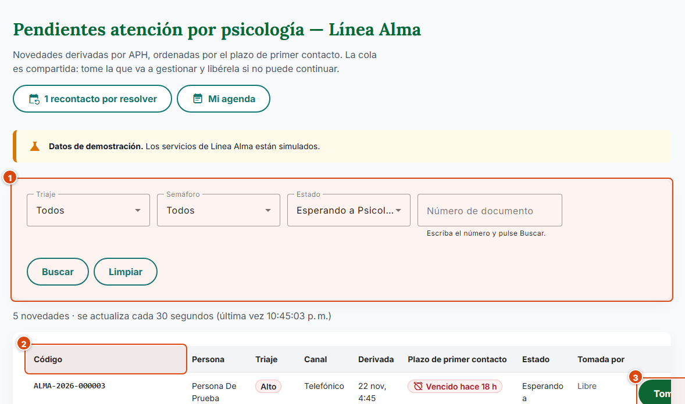

*Captura 14. Pendientes atención por psicología.*

| # | Qué hacer |
|:--:|---|
| **1** | **Filtros:** triaje, semáforo, estado (por defecto, *Esperando a Psicología*) y número de documento. Pulse **Buscar** o **Limpiar**. |
| **2** | Columnas: código, persona, triaje, canal, fecha de derivación, plazo, estado con los intentos hechos («Intentos 3/9») y quién la tomó («Libre», «Usted» o el nombre). Las que corresponden a un recontacto llevan la etiqueta **Recontacto**. |
| **3** | **Tomar** (solo aparece si está libre). Si otra profesional la tiene, el botón es **Ver**; con una novedad suya, **Continuar**. |

Arriba hay atajos a *N recontactos por resolver* y a *Mi agenda*.

### 10.1. La pantalla de la novedad

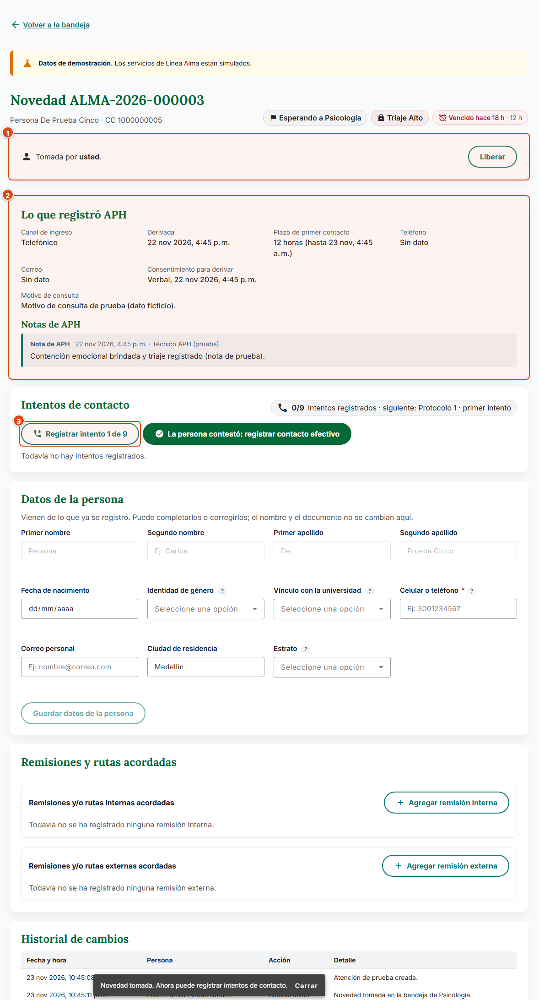

*Captura 15. Novedad tomada, datos de APH e intentos de contacto.*

| # | Qué hacer |
|:--:|---|
| **1** | **Toma:** quién la gestiona; botones *Tomar esta novedad* / *Liberar* (devuelve la novedad a la cola si no puede continuar). |
| **2** | **Lo que registró APH:** canal, plazo, contacto, consentimiento para derivar, motivo de consulta y notas de APH. El **triaje de APH** va con candado: no se edita. |
| **3** | **Intentos de contacto** ([sección 11](#11-intentos-de-contacto)) o, cuando la persona contestó, el **primer contacto efectivo** ([sección 12](#12-primer-contacto-efectivo-y-apertura-del-caso)). |

Debajo siguen **Datos de la persona**, las **remisiones y rutas** previas y el **historial de cambios**. En la parte superior hay alertas: gestión en simultáneo con el Equipo de Atención, y si la persona ya tiene un caso activo (el sistema **no** la vincula por su cuenta).

### 10.2. Datos de la persona

Entre los intentos de contacto y las remisiones hay un bloque nuevo para **completar o corregir** los datos de la persona que APH alcanzó a registrar.

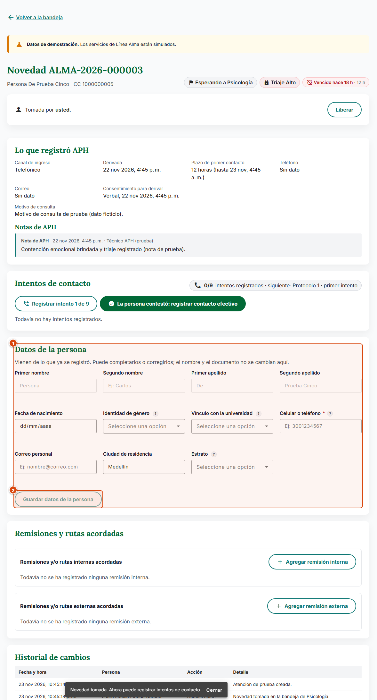

*Captura 16. Datos de la persona en la novedad.*

| # | Qué hacer |
|:--:|---|
| **1** | Vienen **precargados** con lo que registró APH. Puede completar fecha de nacimiento, identidad de género, vínculo con la universidad, celular o teléfono, correo, ciudad y estrato. **Los nombres, los apellidos y el documento no se cambian aquí.** |
| **2** | Pulse **Guardar datos de la persona**. Requiere tener tomada la novedad. |

---

## 11. Intentos de contacto

Con la novedad **tomada por usted**, registre cada llamada que haga a la persona. El contador muestra «0/9 intentos» y cuál es el protocolo del siguiente.

| Intento | Protocolo |
|---|---|
| 1 | **Protocolo 1** · primer intento |
| 2 | **Protocolo 2** · distinto día u horario |
| 3 | **Protocolo 3** · nuevo día u horario |
| 4 al 9 | **Intento adicional**, con justificación obligatoria |

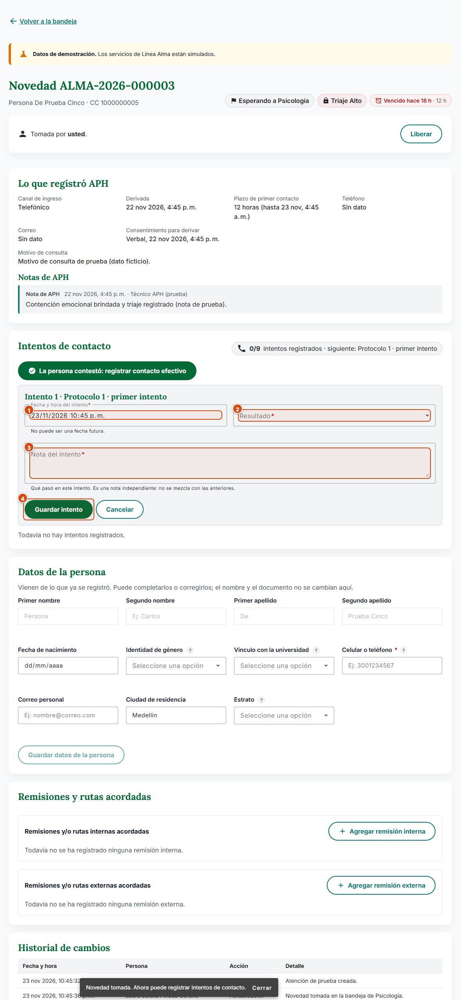

*Captura 20. Registro de un intento de contacto.*

| # | Qué hacer |
|:--:|---|
| **1** | **Fecha y hora** del intento (no puede ser futura). |
| **2** | **Resultado** (por ejemplo, *No contesta*, *Buzón de voz*, *Línea ocupada*, *Teléfono apagado o fuera de servicio*). |
| **3** | **Nota del intento:** es independiente de las anteriores. Desde el 4.º intento aparece además la **justificación del intento adicional**. |
| **4** | Pulse **Guardar intento**. |

> ⚠️ Si el intento se parece al anterior (mismo día o a menos de una hora de diferencia) aparece un **aviso amarillo**. Es solo una advertencia: puede continuar.
> ⚠️ El intento 9 muestra «Es el último intento del protocolo». Si no hay contacto, el sistema **cierra la novedad automáticamente por «No contacto»**.

Los intentos quedan en una lista, del más reciente al más antiguo. Cuando la persona **contesta**, pulse **«La persona contestó: registrar contacto efectivo»**.

---

## 12. Primer contacto efectivo y apertura del caso

Es un formulario de **6 pasos**. Puede **guardar un borrador** en cualquier paso (si vuelve, lo retoma y puede descartarlo) o **volver a los intentos**. Al terminar, el sistema genera el código del caso **CAS-AAAA-NNNNNN**.

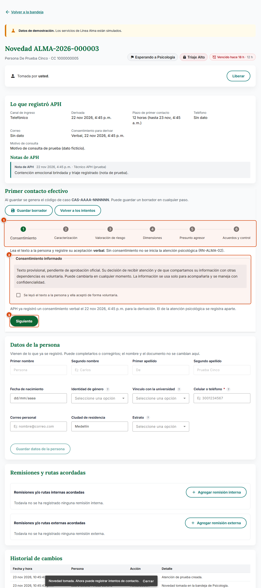

*Captura 21. Primer contacto efectivo, paso 1: consentimiento.*

| # | Qué hacer |
|:--:|---|
| **1** | Los **seis pasos**: consentimiento, caracterización, valoración de riesgo, dimensiones, presunto agresor y acuerdos y control. |
| **2** | Lea el texto a la persona y marque su aceptación **verbal**. Sin consentimiento no se inicia la atención psicológica; el que dio APH para derivar es aparte. |
| **3** | Pulse **Siguiente**. |

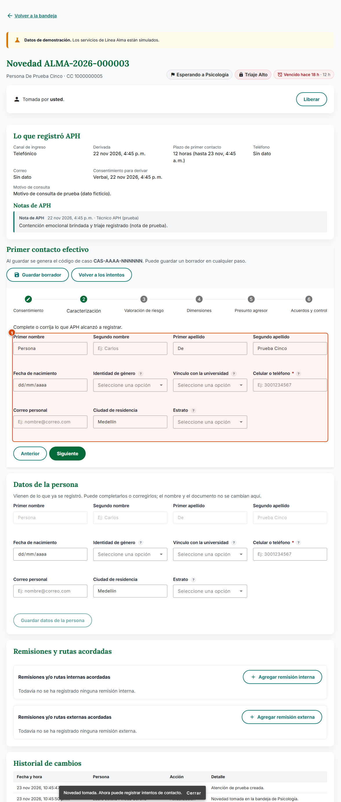

*Captura 22. Paso 2: caracterización.*

| # | Qué hacer |
|:--:|---|
| **1** | Complete o corrija lo que APH alcanzó a registrar. Son los mismos campos de APH, y el **celular o teléfono** es obligatorio. |
| **2** | Pulse **Siguiente**. |

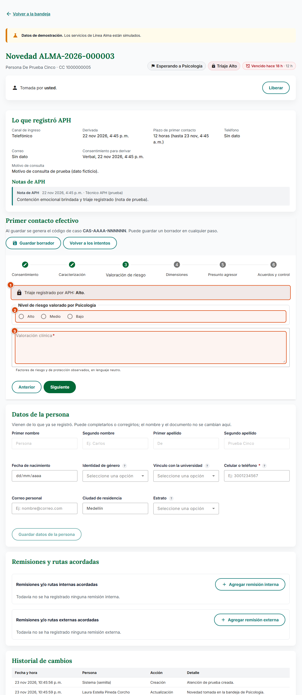

*Captura 23. Paso 3: valoración de riesgo.*

| # | Qué hacer |
|:--:|---|
| **1** | El **triaje de APH** se muestra con candado y **no se modifica**. |
| **2** | Elija el **nivel de riesgo** (Alto, Medio o Bajo) que valora Psicología. |
| **3** | Escriba la **valoración clínica** (obligatoria, mínimo 10 caracteres, en lenguaje neutro). |

El **paso 4** son las **dimensiones** de salud mental que apliquen (hoy figuran como «Dimensión 1…15» hasta recibir el catálogo oficial).

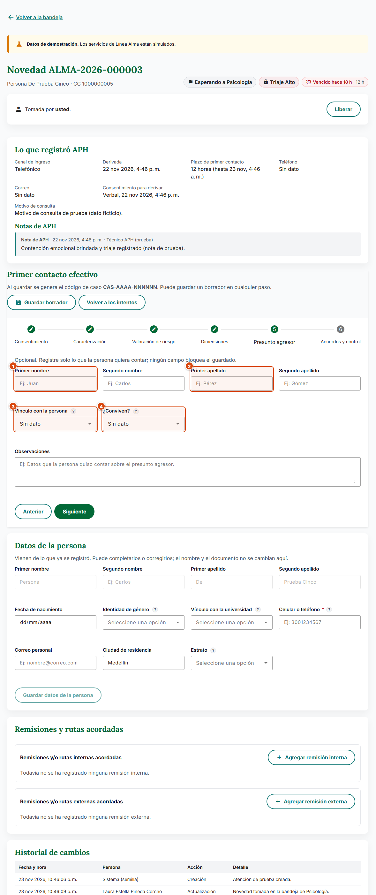

*Captura 24. Paso 5: presunto agresor.*

| # | Qué hacer |
|:--:|---|
| **1** | **Primer y segundo nombre.** Solo letras. |
| **2** | **Primer y segundo apellido.** Solo letras. |
| **3** | **Vínculo con la persona**, del catálogo. |
| **4** | **¿Conviven?** Sí / No. |

Es un paso **opcional**: ningún campo bloquea el guardado. Registre solo lo que la persona quiera contar.

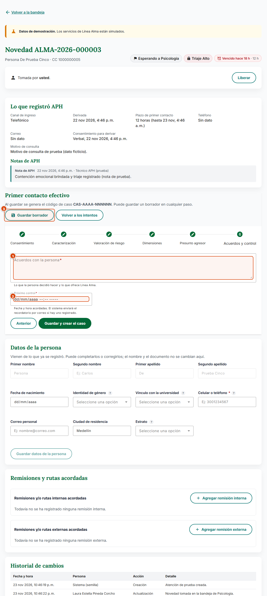

*Captura 25. Paso 6: acuerdos y próximo control.*

| # | Qué hacer |
|:--:|---|
| **1** | Escriba los **acuerdos** con la persona (mínimo 10 caracteres). |
| **2** | Fije el **próximo control** (fecha y hora futuras). Si la persona tiene un correo registrado, el sistema envía el recordatorio. |
| **3** | Pulse **Guardar y crear el caso**. Se abre el expediente del caso nuevo. |

**Si la persona ya tiene un caso activo**, en el paso 6 debe decidir: **vincular** esta atención al caso existente (mismos hechos) o **abrir un caso nuevo** (hechos distintos).

---

## 13. Expediente, seguimientos y cierre del caso

El expediente es la pantalla del caso (`/linea-alma/psicologia/casos/CAS-…`). También se llega desde la novedad, la agenda o el recontacto.

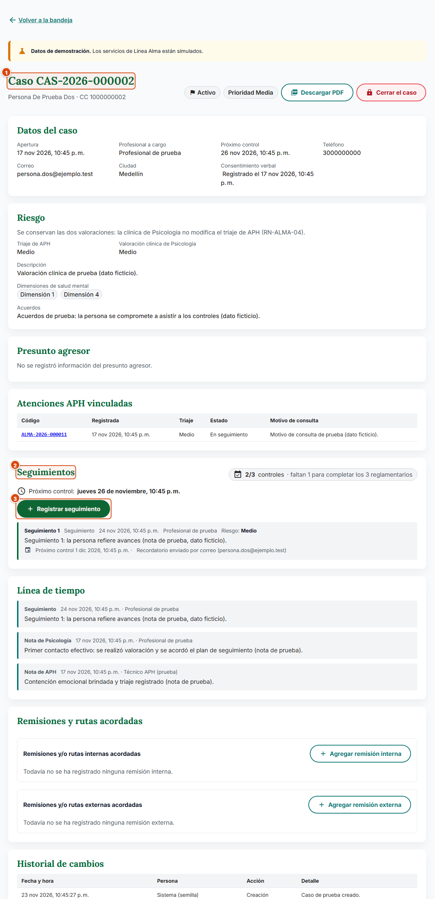

*Captura 18. Expediente del caso.*

| # | Qué hacer |
|:--:|---|
| **1** | **Encabezado:** estado del caso (Abierto, Activo, En cierre, Cerrado), **prioridad** (según el triaje: Alto → Alta, Medio → Media, Bajo → Baja) y, según su rol, **Descargar PDF** y **Cerrar el caso**. |
| **2** | **Seguimientos:** el contador muestra «2/3 controles»: el **primer contacto efectivo cuenta como el control 1** y se esperan **3 reglamentarios** (puede haber más; el expediente sigue abierto). |
| **3** | **Registrar seguimiento.** |

Los demás bloques son: datos del caso, **riesgo** (triaje de APH y valoración clínica, siempre las dos), presunto agresor, atenciones APH vinculadas, línea de tiempo, remisiones y rutas, e historial de cambios.

### 13.1. Registrar un seguimiento

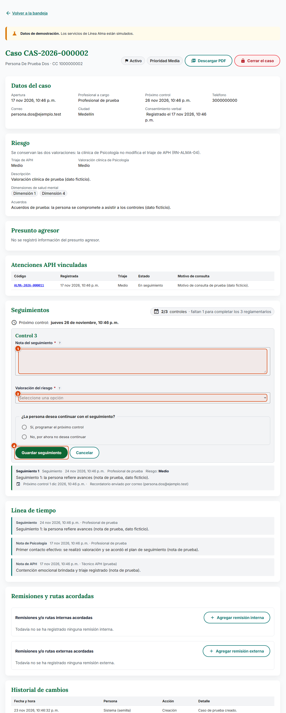

*Captura 26. Registro de un seguimiento.*

| # | Qué hacer |
|:--:|---|
| **1** | Escriba la **nota**: cómo está la persona, qué se trabajó y qué se acordó. |
| **2** | Elija la **valoración del riesgo** (Alto, Medio o Bajo). Es obligatoria en cada seguimiento y **no cambia el triaje** que registró APH; en el historial cada seguimiento muestra su «Riesgo». |
| **3** | Responda **«¿La persona desea continuar con el seguimiento?»** *Sí* → indique el **próximo control** (fecha y hora; el sistema envía el recordatorio por correo si hay uno registrado). *No* → al guardar se le ofrecerá **cerrar el caso**; mientras tanto queda **En cierre**, y si la persona vuelve a comunicarse puede seguir registrando seguimientos. |
| **4** | Pulse **Guardar seguimiento**. |

### 13.2. Cerrar el caso

Disponible para Profesionales y Administración, con el botón **Cerrar el caso** del expediente (o desde la oferta de cierre tras un seguimiento «No desea continuar»).

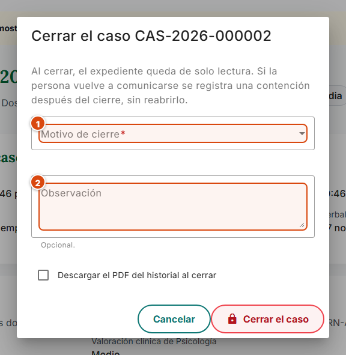

*Captura 27. Diálogo para cerrar el caso.*

| # | Qué hacer |
|:--:|---|
| **1** | Elija el **motivo de cierre** (catálogo; obligatorio). |
| **2** | Escriba una **observación**: es **obligatoria si el motivo es «Otro»**; en los demás casos es opcional. Si su rol lo permite, marque **«Descargar el PDF del historial al cerrar»**. |
| **3** | Pulse **Cerrar el caso**. |

> 🔒 Al cerrar, el expediente queda de **solo lectura**. Si la persona vuelve a comunicarse, **no se reabre**: se registra una *contención después del cierre* ([sección 8.3](#83-contención-después-del-cierre)).

---

## 14. Mi agenda

**Menú → Línea Alma → Mi agenda.** Lista los **controles programados** de los casos activos.

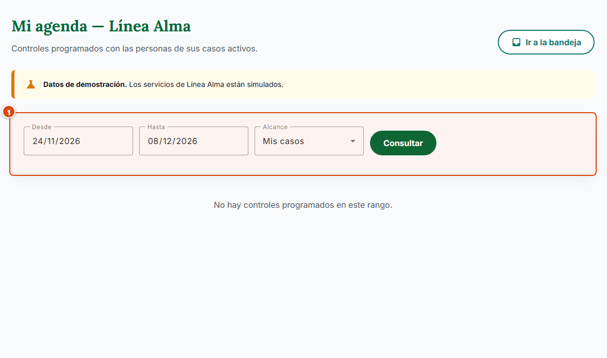

*Captura 19. Agenda de controles.*

| # | Qué hacer |
|:--:|---|
| **1** | Elija el rango **Desde / Hasta** y pulse **Consultar**. Quien puede ver a todo el equipo elige el **alcance**: *Mis casos* o *Todo el equipo*. |
| **2** | Cada control muestra fecha y hora, persona, número de control (por ejemplo, «control 2/3»), profesional, estado del recordatorio y el botón **Abrir el caso**. |

Las etiquetas **Hoy** y **Pendiente de registrar** (control que ya pasó sin seguimiento) ayudan a priorizar.

---

## 15. Recontactos

**Menú → Línea Alma → Recontactos.** Reúne a las personas con un **caso activo** que volvieron a llamar a APH. Cada llamada genera una atención nueva y el sistema **nunca la vincula por su cuenta**: decide Psicología.

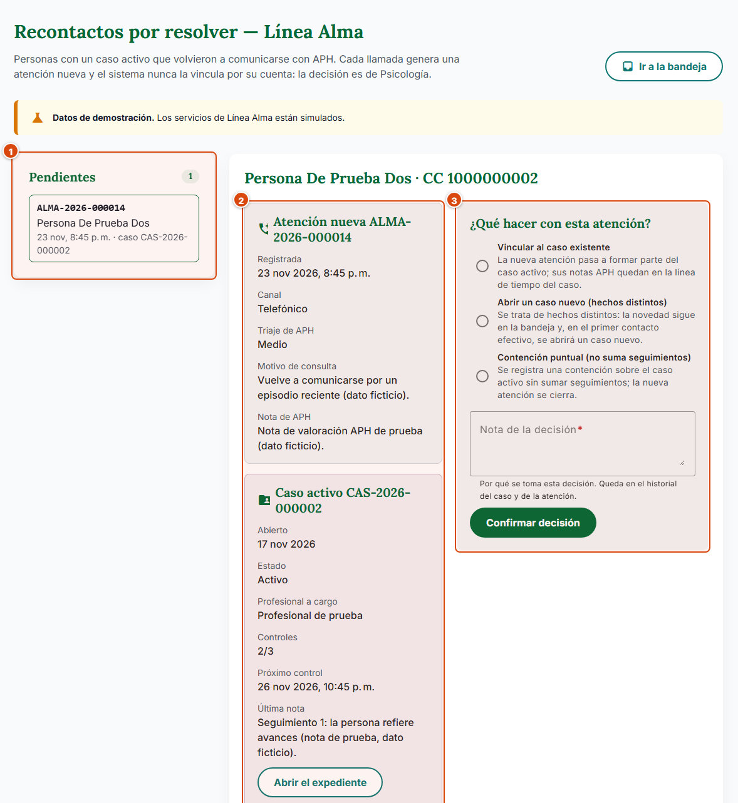

*Captura 17. Resolución de un recontacto.*

| # | Qué hacer |
|:--:|---|
| **1** | Elija un recontacto de la lista de la izquierda; el contador indica cuántos hay pendientes. |
| **2** | Compare, lado a lado, la **atención nueva** (fecha, canal, triaje, motivo, nota de APH) y el **caso activo** (apertura, estado, profesional, controles, próximo control, última nota). Use **Abrir el expediente** si necesita más contexto. |
| **3** | Elija qué hacer con la atención, escriba la **nota de la decisión** (obligatoria; queda en el historial del caso y de la atención) y pulse **Confirmar decisión**. |

| Decisión | Qué ocurre |
|---|---|
| **Vincular al caso existente** | La atención pasa a formar parte del caso activo; sus notas de APH quedan en la línea de tiempo. |
| **Abrir un caso nuevo** (hechos distintos) | La novedad sigue en la bandeja y en el primer contacto efectivo se abre un caso nuevo. |
| **Contención puntual** (no suma seguimientos) | Se registra una contención sobre el caso activo y la nueva atención se cierra. |

---

## 16. Casos de uso de Psicología

| Caso de uso | Situación | Qué hace la profesional | Qué pasa después |
|---|---|---|---|
| **Empieza el turno** | Hay novedades derivadas durante la noche. | Abre *Pendientes atención por psicología*, ordena por plazo y toma primero las del semáforo rojo. | La novedad queda a su nombre y el resto del equipo ve que está tomada. |
| **La persona no contesta** | Llama tres veces y nadie responde. | Registra cada intento con su resultado y nota; desde el cuarto, con justificación. | Al noveno intento sin contacto, la novedad se cierra por «No contacto». |
| **La persona contesta** | En el segundo intento, la persona atiende y acepta. | Pulsa «La persona contestó» y completa los seis pasos. | Se crea el caso `CAS-…` y queda el primer control. |
| **Faltaba un dato** | La persona no había dado su teléfono a APH. | En *Datos de la persona* lo completa y guarda. | La novedad se actualiza; nombres y documento no se tocan. |
| **Seguimiento semanal** | Llega la fecha del control. | Abre el caso desde *Mi agenda*, registra el seguimiento con la valoración del riesgo y fija el próximo control. | La persona recibe el recordatorio por correo. |
| **La persona ya no quiere continuar** | En el cuarto control dice que se siente bien. | Responde «No» a «¿Desea continuar?» y cierra el caso con su motivo. | El expediente queda de solo lectura y se puede descargar el PDF. |
| **Vuelve a llamar con un caso activo** | Una persona con caso abierto llama por otro episodio. | En *Recontactos* compara la atención con el caso y decide: vincular, abrir un caso nuevo o contención puntual. | La decisión queda en el historial del caso y de la atención. |

---

## 17. Mensajes frecuentes

| Mensaje | Qué significa | Qué hacer |
|---|---|---|
| «Elija el canal de ingreso para continuar» | Falta el canal (o la relación, en una solicitud indirecta) | Complételo y pulse *Continuar*. |
| «El triaje se habilita cuando complete los campos obligatorios…» | Falta algo obligatorio del paso 2 | Revise los campos con asterisco y pulse *Guardar y continuar*. |
| «Seleccione el triaje o registre el peligro inminente para continuar» | Falta el triaje | Elija un nivel u omítalo con justificación. |
| «Falta registrar el consentimiento de la persona…» | La derivación exige consentimiento | Lea el texto y marque la casilla, o use peligro inminente si aplica. |
| «Para derivar a Psicología primero registre el triaje» | No hay triaje | Vuelva a *Guardar triaje*. |
| «Antes de continuar consulte el documento…» | No consultó si la persona tiene historial | Pulse *Consultar*. |
| Conflicto al tomar o guardar | Otra persona modificó la atención | Se recarga con la versión más reciente; revise y repita. |
| «No pudimos cargar…» + *Intentar de nuevo* | Falla de red o del servidor | Reintente. Lo ya registrado no se pierde. |
| «Acceso denegado» | Su rol no tiene permiso (o Psicología aún no está habilitada para su rol) | Consulte con Coordinación. |
| «Tome la novedad para registrar intentos de contacto» | La novedad no es suya | Pulse **Tomar esta novedad**. |
| «La novedad ya no está pendiente: no se registran más intentos» | Ya hubo contacto efectivo o se cerró | Revise el estado de la novedad. |
| «Se agotaron los 9 intentos del protocolo» | No quedan intentos | La novedad se cerró por «No contacto». |
| «Otra profesional la está gestionando; puede consultarla, no editarla» | Otra persona tomó la novedad | Elija otra o pida que la libere. |
| «La persona ya tiene un caso activo» | Recontacto de una persona con caso abierto | Decida si vincular o abrir un caso nuevo ([sección 15](#15-recontactos)). |
| Al salir del formulario pregunta por cambios | Hay datos sin guardar | Guarde el borrador o confirme que quiere salir ([sección 6.6](#66-salir-sin-guardar)). |

---

## 18. Buenas prácticas

- **Guarde el borrador** si la llamada se corta o debe atender otra urgencia.
- Escriba el **motivo con las palabras de la persona**, sin juicios ni diagnósticos.
- Pida solo la **caracterización** que la persona quiera dar; el celular o teléfono es lo único obligatorio.
- **Nunca** use datos reales en el entorno de demostración.
- Si llama un tercero, registre **sus** datos como «quien se comunica» y los de la persona afectada en el paso 2.
- En Psicología, **libere** la novedad si no va a continuar, para que otra profesional pueda tomarla.
- Distinga los intentos de contacto: **otro día y otro horario** que el intento anterior.
- La valoración clínica y el triaje de APH son **dos datos distintos**: nunca se sobrescriben.
- Use **Salida rápida** (botón flotante, `Alt + Q` o doble `Esc`) si necesita cerrar la pantalla de inmediato por seguridad.

---

## 19. Cómo practicar con datos de demostración

Con el servidor simulado activo puede usar estas cédulas ficticias (tipo CC) en el paso 2 del registro:

| Documento | Escenario |
|---|---|
| `1000000002` | Seguimiento psicológico activo (próximo control en 3 días) |
| `1000000003` | Caso cerrado `CAS-2026-000003` (para practicar contención) |
| `1000000008` | Seguimiento psicológico activo (próximo control en 1 día) |
| `1000000004` a `1000000007`, `1000000009`, `1000000010` | Personas sin escenario especial |
| `2000000001` a `2000000003` | Remisiones de prueba que aparecen en la bandeja |

### Psicología (ingrese con una cuenta de Administración)

La bandeja de Psicología trae estas situaciones ficticias; los códigos `ALMA-…` los muestra la propia bandeja:

| Qué verá | Para practicar |
|---|---|
| Novedad de triaje **Alto** con plazo **vencido** (documento `1000000005`) | Semáforo rojo, toma de una novedad y primer contacto. |
| Novedad con **3 intentos** (`1000000006`) | El intento 4 exige justificación. |
| Novedad con **8 intentos** (`1000000007`) | El intento 9 cierra por «No contacto». |
| Novedad **ya tomada por otra profesional** | Modo solo consulta. |
| **Recontacto** de `1000000002` con el caso `CAS-2026-000002` activo | Resolver un recontacto. |
| Casos `CAS-2026-000002`, `…000003` (cerrado), `…000008` y `…000010` | Expediente, seguimientos, agenda y cierre. |

> Estas cuentas y datos existen solo con la configuración de desarrollo (`environment.lineaAlma.mocks`). **Nunca** se activan en un entorno desplegado.

---

## 20. Glosario

| Término | Significado |
|---|---|
| **APH** | Atención Psicológica Humanizada: primer respondiente de la línea. |
| **Atención** | Registro de una llamada, mensaje o remisión. Código `ALMA-AAAA-NNNNNN`. |
| **Solicitud directa / indirecta** | Directa: la persona afectada se comunica. Indirecta: un tercero informa la situación de otra persona. |
| **Triaje** | Nivel de prioridad (Alto, Medio, Bajo) dado por la herramienta de triaje. |
| **Primer contacto** | Primera comunicación de Psicología con la persona; tiene plazo según el triaje. |
| **Peligro inminente** | Riesgo para la vida que permite omitir el triaje y activar remisiones sin consentimiento previo. |
| **Remisión** | Solicitud que llega de EA, SPyB o UAD, o derivación que APH o Psicología hacen a una instancia interna o entidad externa. |
| **SPyB** | Seguridad a Personas y Bienes. |
| **UAD** | Unidad de Asuntos Disciplinarios. |
| **Novedad** | Atención derivada por APH que espera ser gestionada en la bandeja de Psicología (también, el aviso de seguimiento de una remisión). |
| **Semáforo de plazo** | Verde (queda más de la mitad del plazo), amarillo (entre el 50 % y el 20 %), rojo (menos del 20 % o vencido). |
| **Intento de contacto** | Cada llamada de Psicología para lograr el primer contacto; máximo 9. |
| **Contacto efectivo** | La persona contestó y acepta la atención psicológica; abre el caso. |
| **Caso (`CAS-AAAA-NNNNNN`)** | Expediente que Psicología abre en el primer contacto efectivo. |
| **Valoración clínica** | Nivel de riesgo (Alto, Medio, Bajo) que valora Psicología; no cambia el triaje de APH. |
| **Control / seguimiento** | Sesión de seguimiento del caso; el primer contacto cuenta como el control 1 y se esperan 3 reglamentarios. |
| **Recontacto** | Persona con caso activo que vuelve a llamar a APH; Psicología decide cómo tratarlo. |
| **Expediente** | Pantalla del caso con riesgo, seguimientos, línea de tiempo, remisiones e historial. |
| **Contención post-cierre** | Nota de acompañamiento a una persona con caso cerrado; no reabre el caso. |

---
