# Manual de usuario — Seguridad a personas y bienes (SPyB)

> **Para quién es:** personal de vigilancia y supervisores de campus, operadores de la Central de monitoreo (línea 219-64-19), analistas de riesgos, Coordinación de Seguridad a personas y bienes y Equipo CASILDA.
> **Versión:** 19 de noviembre de 2026 · **Alcance:** módulo completo de Seguridad a personas y bienes (`/seguridad/*`). Las pantallas se explican en el mismo orden del menú lateral.

> ⚠️ **Datos de demostración.** Mientras Backend no publique los servicios del módulo, funciona con un servidor simulado y verá un aviso amarillo «Datos de demostración». **Nada de lo que registre llega al sistema real** y las personas que aparecen son ficticias.

> 🔎 **Cómo leer las capturas.** Los **círculos numerados** de color naranja señalan dónde actuar. Cada captura va seguida de una tabla con el mismo número que dice qué hacer en ese punto.

---

## 1. Qué hace este módulo

Seguridad a personas y bienes (SPyB) atiende los hechos de seguridad física que afectan a la comunidad universitaria en los campus: recibe el reporte, lo analiza, lo conecta con los casos de la Ruta Violeta cuando corresponde y coordina las medidas de protección en campo.

1. **Analizar y clasificar** cada reporte en la bandeja del analista: pedir que lo corrijan, vincularlo a un caso o cerrarlo como independiente.
2. **Consultar medidas de protección activas** de una persona y **registrar llamadas** o atención presencial (Central de monitoreo).
3. **Reportar desde campo**: vigilantes y supervisores registran lo ocurrido en su ronda.
4. **Emitir órdenes de acompañamiento** para que un vigilante acompañe a una persona, con un enlace seguro.
5. **Solicitar grabaciones de cámaras** y seguir su cadena de custodia, sin guardar videos en CASILDA.
6. **Remitir** a Equipo de atención, Línea Alma, UAD o una entidad externa.
7. **Ver indicadores** de oportunidad, efectividad y vinculación.

> 🔒 **Privacidad: Persona ≠ Caso CASILDA ≠ Actuación de seguridad.** El personal de vigilancia y los operadores de la Central **nunca ven notas clínicas, relatos sensibles ni expedientes disciplinarios**; solo lo necesario para actuar. **Vincular una actuación a un caso es una decisión manual del analista**, con justificación obligatoria: el sistema nunca vincula solo por coincidencia de cédula.

---

## 2. Quién puede hacer qué

| Acción | Vigilancia | Central | Analista | Coordinación | Administración |
|---|:--:|:--:|:--:|:--:|:--:|
| Ver la bandeja del analista | — | — | ✅ | ✅ | ✅ |
| Vincular, subsanar o cerrar como independiente | — | — | ✅ | ✅ | ✅ |
| Emitir órdenes, pedir cámaras y remitir | — | — | ✅ | ✅ | ✅ |
| Consultar medidas de protección activas | — | ✅ | ✅ | ✅ | ✅ |
| Registrar una llamada o recepción presencial | — | ✅ | ✅ | ✅ | ✅ |
| Registrar una novedad desde campo | ✅ | ✅ | ✅ | ✅ | ✅ |
| Ver el tablero de indicadores | — | — | ✅ | ✅ | ✅ |
| Ejecutar una orden (enlace seguro) | ✅ | — | ✅ | ✅ | ✅ |

Los roles son `SPB_VIGILANTE`, `SPB_CENTRAL`, `SPB_ANALISTA`, `SPB_COORDINACION` y `ADMIN`. Las opciones que su rol no puede usar **no aparecen en el menú**.

---

## 3. Cómo entrar

1. Inicie sesión en CASILDA con su cuenta institucional.
2. En el menú lateral busque la sección **Seguridad (SPyB)**. Según su rol verá, **en este orden**: Bandeja del analista, Central de monitoreo, Reporte de vigilancia e Indicadores SPyB.
3. Los vigilantes que ejecutan una orden **no navegan por el menú**: reciben un enlace directo `/seguridad/orden/:token`.

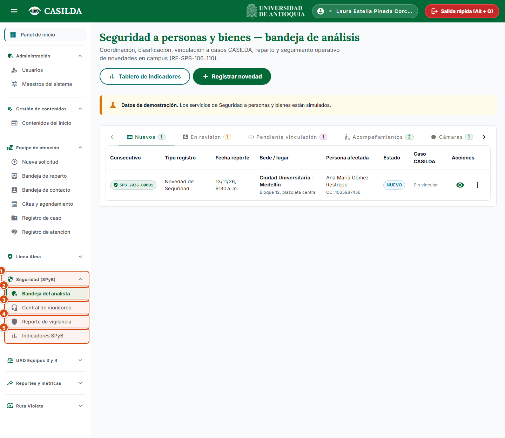

*Captura 1. Menú lateral con la sección Seguridad (SPyB).*

| # | Qué hacer |
|:--:|---|
| **1** | Abra o cierre la sección **Seguridad (SPyB)** con un clic. |
| **2** | **Bandeja del analista** (`/seguridad/bandeja`): donde se clasifica y reparte el trabajo. |
| **3** | **Central de monitoreo** (`/seguridad/central`): consulta de medidas y recepción de llamadas. |
| **4** | **Reporte de vigilancia** (`/seguridad/reportar`): formulario para quien está en campo. |
| **5** | **Indicadores SPyB** (`/seguridad/indicadores`): tablero de métricas. |

---

## 4. ¿Recepción en la Central o reporte de vigilancia?

Las dos pantallas **crean el mismo tipo de registro**: una actuación con consecutivo `SPB-AAAA-NNNNN` que llega a la pestaña **Nuevos** de la bandeja del analista. Lo que cambia es **quién la usa, en qué momento y cuánta información pide**.

| | **Central de monitoreo** (pestaña «Registrar recepción de situación») | **Reporte de vigilancia** («Reporte rápido de novedades en ronda») |
|---|---|---|
| **Quién la usa** | Operador de la Central. | Vigilante o supervisor en campo. |
| **Cuándo** | Mientras atiende **una llamada** (línea 219-64-19), a una persona en ventanilla o un correo. | Cuando **ve o atiende algo durante su ronda** o en la portería. |
| **Quién aparece como reportante** | El operador de la Central (ya viene definido). | El supervisor, que **debe identificarse** (cédula, nombre y cargo). |
| **Pide el canal** | Sí: línea 219-64-19, correo, presencial, ronda u otro. | No: queda como «ronda operativa». |
| **Datos de la persona** | Completos: documento, nombres, teléfono, correo y **vínculo con la Universidad**. | Esenciales: documento, nombres y teléfono. |
| **Consentimiento de la persona** | **Sí**: lectura del consentimiento informado y autorización de la Ruta Violeta. | No. |
| **Consulta de medidas activas** | **Sí**, en la otra pestaña de la misma pantalla. | No. |
| **Extensión** | Formulario completo, 4 secciones. | Formulario corto, 4 secciones. |

**Regla práctica:** si **le llegó** una llamada o una persona, use la **Central**. Si **lo vio usted** en campo, use el **Reporte de vigilancia**.

---

## 5. Mapa general del proceso

**Parte 1 — De la llegada al registro**

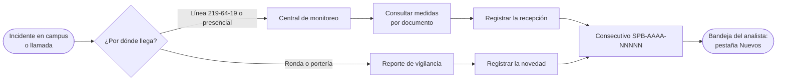

**Parte 2 — Del análisis al trámite**

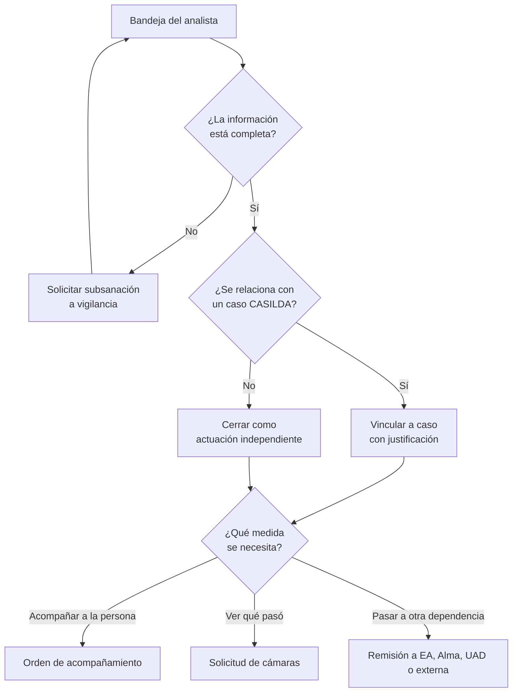

---

## 6. Estados de una actuación

| Estado en pantalla | Qué significa |
|---|---|
| **Nuevo** | Llegó desde la Central o Vigilancia y nadie la ha revisado. |
| **En revisión** | El analista la está evaluando. |
| **Subsanación requerida** | Tiene datos incompletos y se devolvió a vigilancia para que los aclare. |
| **Pendiente vinculación** | Ya se analizó; falta decidir si pertenece a un caso de CASILDA. |
| **Vinculado a caso** | Se asoció a un caso de la Ruta Violeta (`CAS-AAAA-NNNN`), con justificación. |
| **Actuación independiente** | Se gestionó solo como tema de seguridad, sin relación con un caso. |
| **Cerrado** | Todas las órdenes y trámites terminaron. |

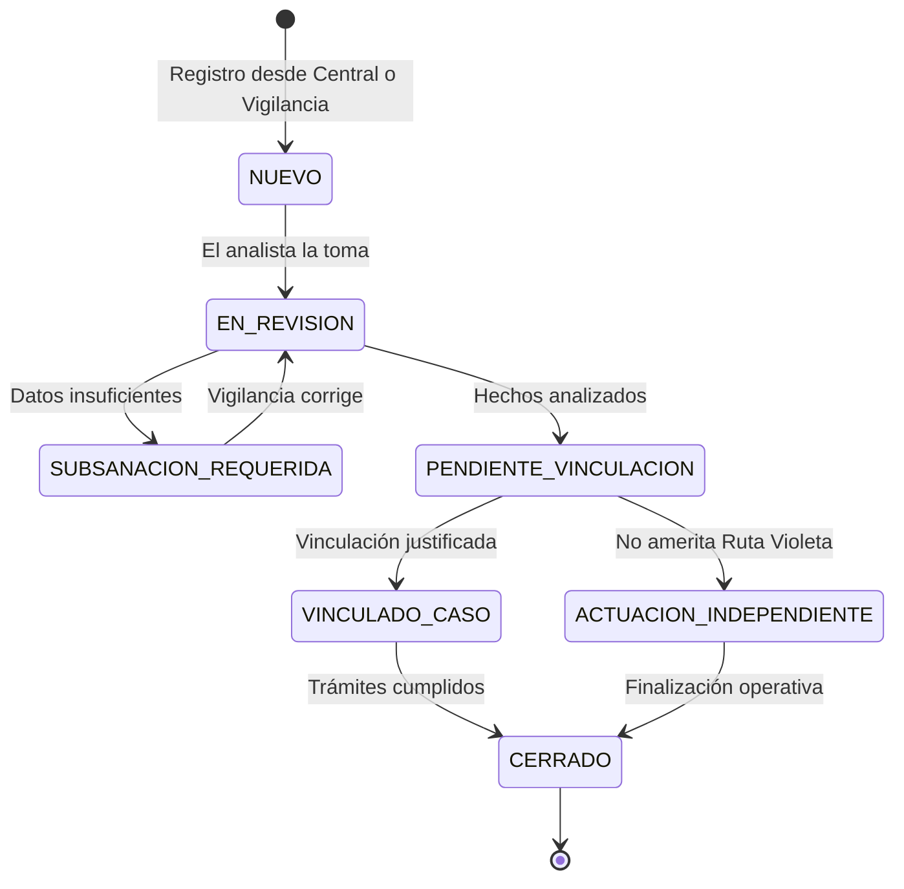

> ℹ️ En la demostración, los datos de ejemplo ya traen actuaciones en varios estados. Los pasos entre *En revisión* y *Pendiente vinculación* los fijará el backend cuando esté conectado.

---

## 7. Bandeja del analista

**Menú → Seguridad (SPyB) → Bandeja del analista.** Es la lista de trabajo del analista: todo lo que llega desde la Central o Vigilancia aparece aquí como una fila, y desde aquí se decide qué hacer con cada actuación.

> 💡 **La idea clave:** cada fila es una **actuación** (un reporte con consecutivo `SPB-AAAA-NNNNN`). El analista la va moviendo de una etapa a otra hasta cerrarla.

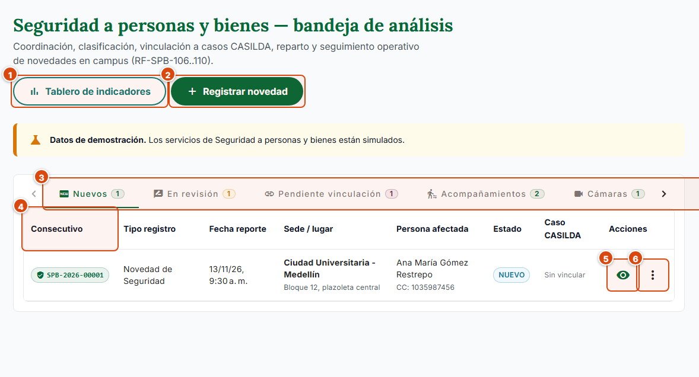

*Captura 2. Bandeja del analista con la pestaña «Nuevos».*

| # | Qué hacer |
|:--:|---|
| **1** | **Tablero de indicadores:** abre las métricas del módulo. |
| **2** | **Registrar novedad:** abre el formulario de reporte para registrar algo directamente. |
| **3** | **Pestañas con contador.** El número dice cuántos elementos hay en esa etapa. |
| **4** | **Tabla de actuaciones:** una fila por actuación, con consecutivo, tipo, fecha, sede, persona, estado y caso. |
| **5** | **Ojo:** abre la ficha completa de la actuación (sección 7.4). |
| **6** | **Tres puntos:** abre el menú de gestión (sección 7.3). |

### 7.1. Las pestañas, de izquierda a derecha

| Pestaña | Qué contiene | Qué hace el analista |
|---|---|---|
| **Nuevos** | Actuaciones recién llegadas que nadie ha revisado. | Las lee y decide el paso siguiente. Es la pestaña de entrada. |
| **En revisión** | Las que ya está evaluando, incluidas las devueltas a vigilancia. | Espera la corrección o termina el análisis. |
| **Pendiente vinculación** | Actuaciones analizadas a las que falta decidir si pertenecen a un caso. | Las vincula a un caso o las cierra como independientes. |
| **Acompañamientos** | Órdenes para que un vigilante acompañe a una persona. | Sigue su estado y copia el enlace seguro. |
| **Cámaras** | Solicitudes de video a las cámaras de seguridad. | Sigue si el video se extrajo, se entregó o no está disponible. |
| **Remisiones** | Lo enviado a Equipo de atención, Línea Alma, UAD o entidades externas, con su estado y los números de recibido o radicado. | Actualiza el estado de cada envío. |
| **Requerimientos UAD** | Citaciones a vigilantes como testigos y el estado de la notificación. | Verifica la notificación y la reenvía si hace falta. |

Las tres primeras pestañas muestran **actuaciones**. Las otras cuatro muestran **trámites que el analista creó** a partir de una actuación.

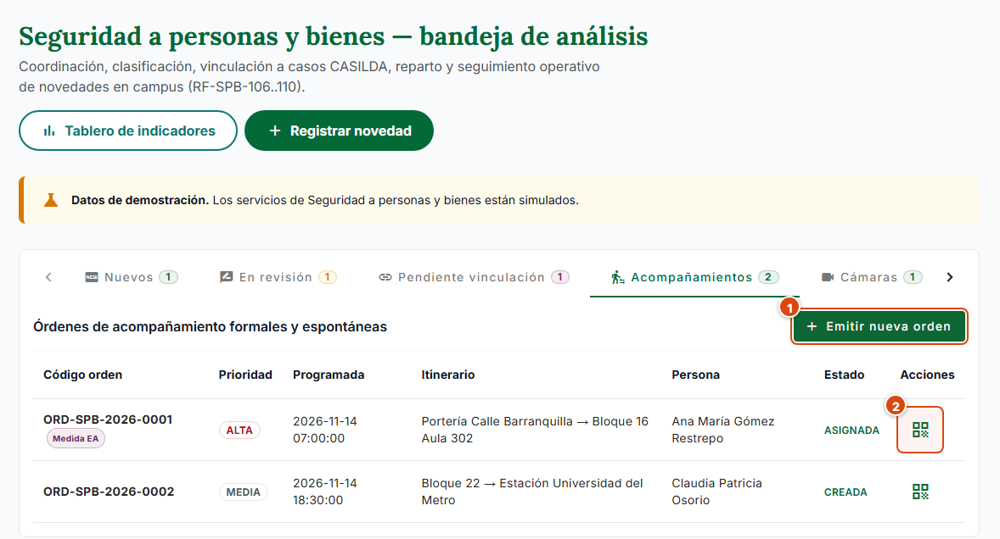

*Captura 3. Pestaña «Acompañamientos».*

| # | Qué hacer |
|:--:|---|
| **1** | **Emitir nueva orden:** crea una orden sin partir de una actuación. |
| **2** | **Código QR:** copia el **enlace seguro** de la orden para enviarlo al vigilante por un canal institucional. |

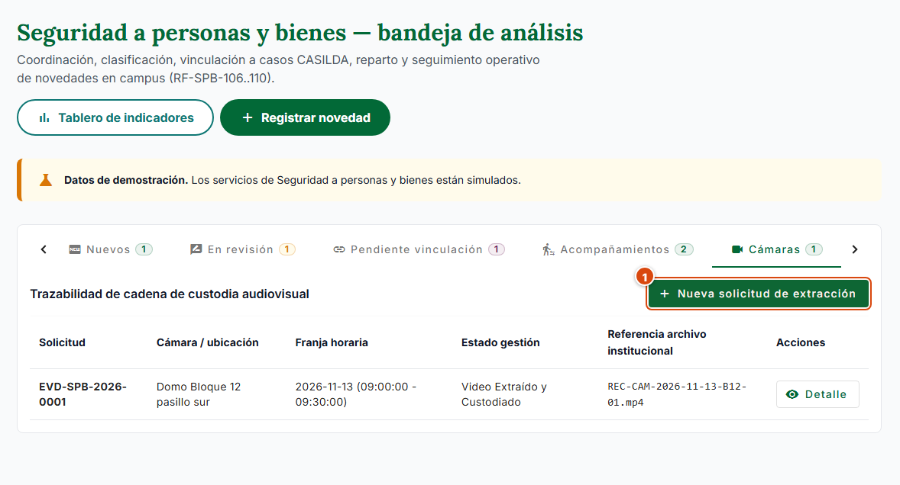

*Captura 4. Pestaña «Cámaras».*

| # | Qué hacer |
|:--:|---|
| **1** | **Nueva solicitud de extracción:** registra la solicitud de un video sin partir de una actuación. |

### 7.2. Casos de uso: para qué sirve cada función

| Caso de uso | Situación | Qué hace el analista | Qué pasa después |
|---|---|---|---|
| **El reporte llegó incompleto** | Un vigilante reportó un altercado pero no dijo el lugar exacto. | Menú de gestión → **Solicitar subsanación a vigilancia** y escribe qué falta. | La actuación pasa a *Subsanación requerida* y el supervisor recibe la solicitud. Cuando corrige, vuelve a revisión. |
| **La persona ya tiene un caso** | Una estudiante que tiene un caso abierto en la Ruta Violeta reporta que la siguieron. | **Vincular a caso CASILDA**: revisa el caso sugerido, escribe la justificación y confirma. | La actuación pasa a *Vinculado a caso* y queda en la auditoría del caso. |
| **El hecho no tiene relación con un caso** | Le robaron una bicicleta a una persona que sí tiene un caso abierto. | **Cerrar como actuación independiente** y escribe el motivo. | Se archiva sin tocar el expediente reservado de la persona. |
| **La persona tiene miedo de salir** | Una persona con medida de protección debe salir del campus a las 6 p. m. | **Emitir orden de acompañamiento** con origen, destino, hora y prioridad alta; copia el enlace desde *Acompañamientos*. | El vigilante abre el enlace, acompaña y registra el informe; la orden pasa a *Finalizada*. |
| **Hay que saber qué pasó** | Se necesita ver quién estaba en el bloque 22 entre las 2:15 y las 2:45 p. m. | **Solicitar grabación de cámara** con ubicación, fecha, franja y motivo. | Aparece en *Cámaras*; el analista sigue la extracción y la entrega. |
| **El caso requiere otra dependencia** | La persona necesita contención psicológica o hay que iniciar un proceso disciplinario. | **Remitir a EA / UAD / Alma**, elige el destino y escribe el motivo. | Aparece en *Remisiones*; si es UAD, se registra el recibido y se pueden citar vigilantes en *Requerimientos UAD*. |
| **Revisión del día** | Al empezar el turno. | Recorre las pestañas: **Nuevos** (qué llegó), **En revisión** (qué espera respuesta) y **Acompañamientos, Cámaras y Remisiones** (trámites abiertos). | Ninguna actuación queda sin decisión. |

### 7.3. El menú de gestión de una actuación

Pulse los **tres puntos** de la fila para abrir el menú.

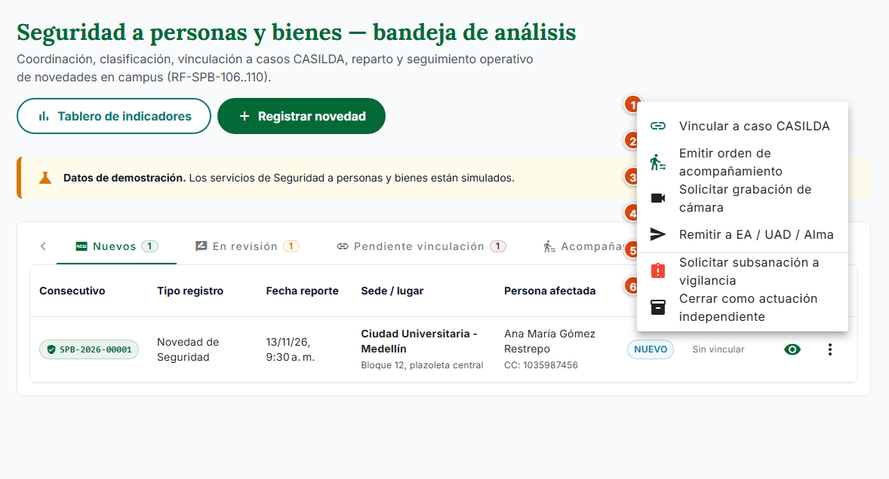

*Captura 5. Menú de gestión de una actuación.*

| # | Opción | Cuándo usarla |
|:--:|---|---|
| **1** | **Vincular a caso CASILDA** | Los hechos se relacionan con un caso de Ruta Violeta. Solo aparece si la actuación aún no tiene caso. |
| **2** | **Emitir orden de acompañamiento** | Una persona necesita que un vigilante la acompañe. |
| **3** | **Solicitar grabación de cámara** | Hay que buscar un video de una franja y un lugar. |
| **4** | **Remitir a EA / UAD / Alma** | El caso debe pasar a otra dependencia. |
| **5** | **Solicitar subsanación a vigilancia** | El reporte tiene datos incompletos. |
| **6** | **Cerrar como actuación independiente** | El hecho no tiene relación con la Ruta Violeta. |

**Vincular a caso CASILDA.** El sistema cruza la cédula con los casos existentes y **sugiere coincidencias**. Revise que de verdad correspondan, complete el **ID del caso** y la **justificación**, y confirme.

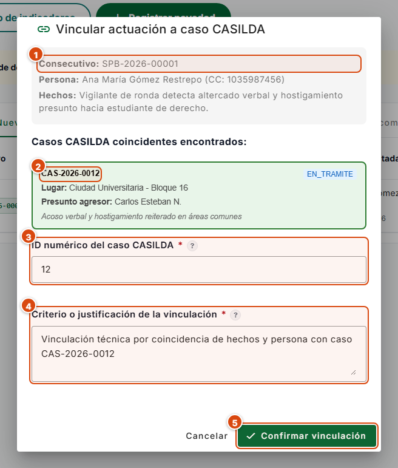

*Captura 6. Ventana para vincular una actuación a un caso.*

| # | Qué hacer |
|:--:|---|
| **1** | Revise el resumen de la actuación: consecutivo, persona y hechos. |
| **2** | **Caso sugerido.** Compare el lugar y los hechos antes de aceptarlo. |
| **3** | Escriba el **ID numérico del caso** (solo números). |
| **4** | Escriba el **criterio o justificación** (mínimo 10 caracteres). Queda en la auditoría. |
| **5** | Pulse **Confirmar vinculación**. |

> 🔒 El sistema **nunca vincula solo** por coincidencia de cédula: una persona puede haber vivido un hurto sin relación con su caso de Ruta Violeta.

**Solicitar subsanación a vigilancia.** Escriba qué debe corregir o ampliar el vigilante y pulse **Enviar solicitud de subsanación**.

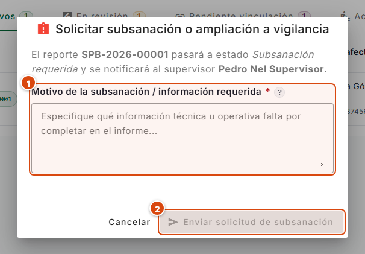

*Captura 7. Ventana para solicitar la subsanación.*

| # | Qué hacer |
|:--:|---|
| **1** | Indique con claridad qué dato falta o es inconsistente (mínimo 10 caracteres). |
| **2** | Pulse **Enviar solicitud de subsanación**. |

**Emitir una orden de acompañamiento.** Los datos de la persona y el origen vienen del registro. Complete la orden y pulse **Generar orden y token**; luego copie su enlace desde la pestaña *Acompañamientos*.

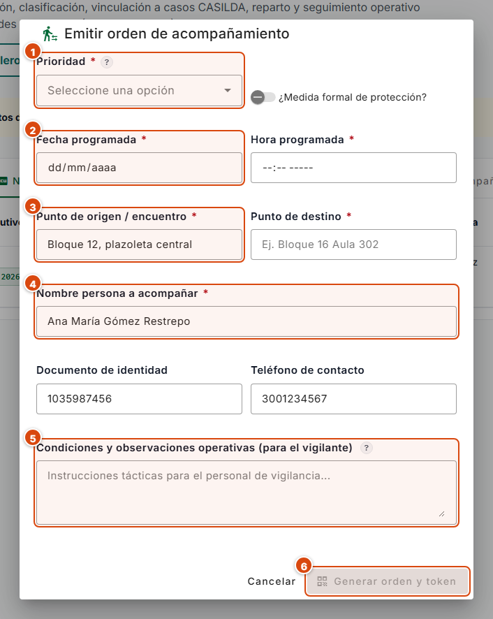

*Captura 8. Ventana para emitir una orden de acompañamiento.*

| # | Qué hacer |
|:--:|---|
| **1** | Elija la **prioridad**: alta (inmediata o por medida de protección), media (programada) o baja (preventiva). |
| **2** | Indique la **fecha y la hora**. No pueden estar en el pasado. |
| **3** | Escriba el **punto de origen** y el **destino**. |
| **4** | Confirme el **nombre, documento y teléfono** de la persona a acompañar. |
| **5** | Escriba las **condiciones para el vigilante**: solo instrucciones tácticas, nunca información del caso. |
| **6** | Pulse **Generar orden y token**. |

**Solicitar una grabación de cámara.** CASILDA registra la **cadena de custodia**, no los videos: los archivos quedan en el almacenamiento institucional.

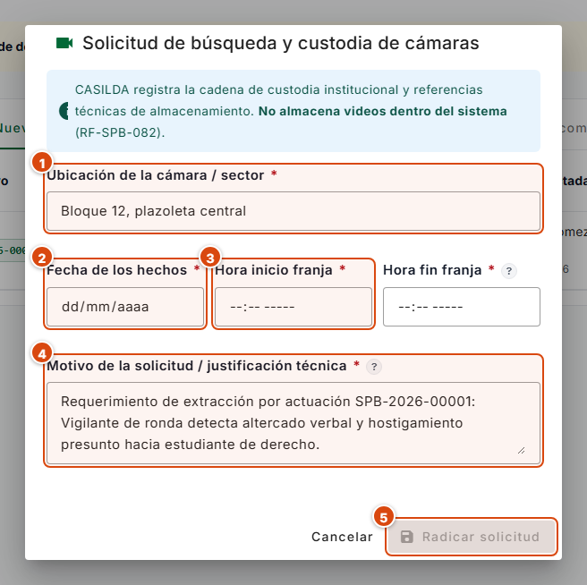

*Captura 9. Ventana para solicitar la búsqueda y custodia de cámaras.*

| # | Qué hacer |
|:--:|---|
| **1** | Escriba la **cámara o el sector** donde se busca el video. |
| **2** | Indique la **fecha de los hechos** (no puede ser futura). |
| **3** | Indique la **hora de inicio y de fin** de la franja. La de fin debe ser posterior. Entre más corta, más rápida la extracción. |
| **4** | Escriba el **motivo o la justificación técnica**. |
| **5** | Pulse **Radicar solicitud**. |

**Remitir a otra dependencia.** Elija el destino y escriba el motivo.

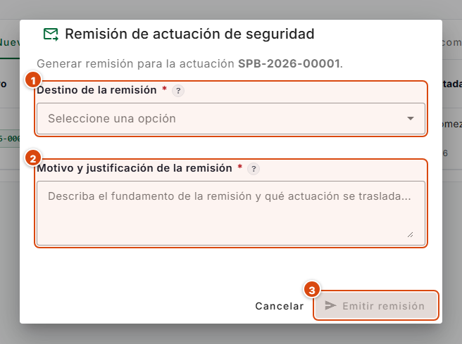

*Captura 10. Ventana para remitir una actuación.*

| # | Qué hacer |
|:--:|---|
| **1** | Elija el **destino**: Equipo de atención (valoración psicosocial y jurídica), Línea Alma (contención), UAD (proceso disciplinario) o entidad externa (Fiscalía, Policía u otra; pide el nombre de la entidad). |
| **2** | Escriba el **motivo y la justificación**. Lo verá la dependencia que recibe. |
| **3** | Pulse **Emitir remisión**. |

**Cerrar como actuación independiente.** El navegador abre un cuadro que pide el **motivo**. Escríbalo y acepte: la actuación se archiva.

### 7.4. Ficha de una actuación

Pulse el **ojo** de la fila para abrir la ficha completa. Desde ahí se hacen las mismas gestiones del menú.

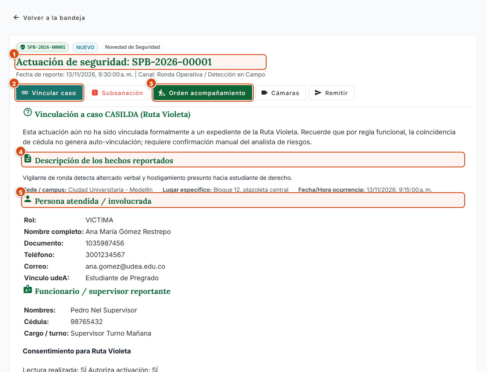

*Captura 11. Ficha de una actuación con sus datos y acciones.*

| # | Qué hacer |
|:--:|---|
| **1** | **Encabezado:** consecutivo, estado, tipo de registro, fecha y canal de recepción. |
| **2** | **Vincular caso:** abre la ventana de vinculación. Junto a ella están **Subsanación**, **Orden acompañamiento**, **Cámaras** y **Remitir**. |
| **3** | **Orden acompañamiento:** crea la orden con los datos de esta actuación. |
| **4** | **Descripción de los hechos**, con la sede y el lugar. |
| **5** | **Persona atendida** y supervisor reportante. Más abajo están el consentimiento y la bitácora de auditoría. |

Use **Volver a la bandeja** para regresar a la lista.

---

## 8. Central de monitoreo

**Menú → Seguridad (SPyB) → Central de monitoreo.** Tiene dos pestañas: consultar si una persona tiene medida de protección y registrar la llamada o atención.

### 8.1. Consultar medidas de protección

Úsela mientras atiende una llamada o a una persona en ventanilla: le dice en segundos si esa persona tiene una medida de protección vigente.

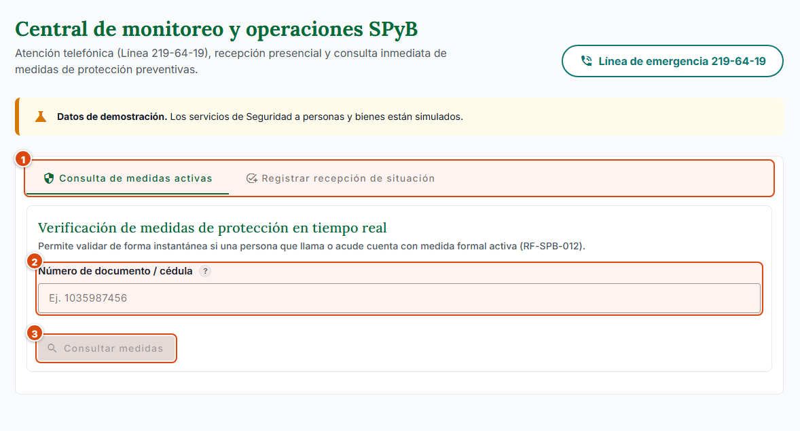

*Captura 12. Pestaña «Consulta de medidas activas».*

| # | Qué hacer |
|:--:|---|
| **1** | Esta es la pestaña **Consulta de medidas activas**; la otra es *Registrar recepción de situación*. |
| **2** | Escriba el **número de documento**, solo números (entre 5 y 20 dígitos). |
| **3** | Pulse **Consultar medidas** o `Enter`. El botón se habilita cuando el documento es válido. |

| Resultado | Qué verá | Qué hacer |
|---|---|---|
| **Medida de protección activa** | Cuadro rojo con el caso, la medida, su vigencia y las condiciones operativas. | Aplique las condiciones y, si hace falta, emita una orden de acompañamiento. |
| **Sin medida vigente** | Cuadro gris: «Sin medida de protección vigente registrada». | Siga con la atención normal. Si la persona se siente insegura, registre la recepción (8.2). |

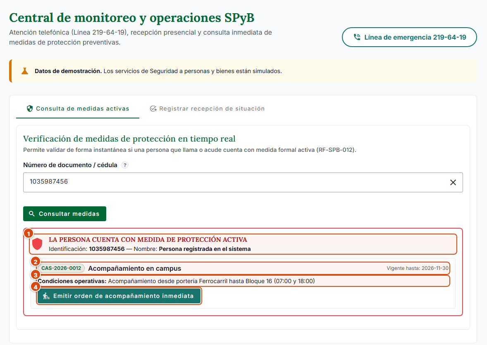

*Captura 13. Resultado de la consulta con medida de protección activa.*

| # | Qué hacer |
|:--:|---|
| **1** | Confirme que el documento y el resultado corresponden a la persona que atiende. |
| **2** | **Caso y tipo de medida**, con su fecha de vigencia. |
| **3** | **Condiciones operativas:** lo que debe hacer el personal de seguridad. |
| **4** | Pulse **Emitir orden de acompañamiento inmediata** para crear la orden con los datos de la medida. |

> 💡 **Para practicar:** use el documento `1035987456`; devuelve una medida activa.

### 8.2. Registrar una llamada o recepción presencial

Abra la pestaña **Registrar recepción de situación** («Recepción de solicitud o situación de seguridad»). Recuerde cuándo usarla en la sección 4.

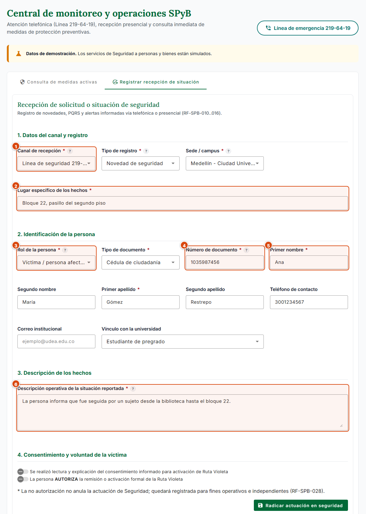

*Captura 14. Formulario de recepción de una situación de seguridad.*

| # | Qué hacer |
|:--:|---|
| **1** | **Canal, tipo de registro y sede.** Elija el canal (línea 219-64-19, correo, presencial…), el tipo (novedad, alerta temprana, PQRS, informe de acompañamiento) y la sede. |
| **2** | Escriba el **lugar específico**: bloque, plazoleta o portería. |
| **3** | **Rol de la persona:** persona afectada, persona señalada u otro interviniente o testigo. |
| **4** | Elija el **tipo de documento** y escriba el **número**. Solo acepta los caracteres del tipo elegido. |
| **5** | Escriba **primer nombre, segundo nombre, primer apellido y segundo apellido**, cada uno en su campo. Teléfono (7 a 12 dígitos), correo y vínculo con la Universidad son opcionales. |
| **6** | **Descripción de los hechos:** relato objetivo, mínimo 10 caracteres. Describa qué pasó, no opiniones. |

La última sección pide el **consentimiento de la persona**. Los dos interruptores **empiezan apagados**: active el primero solo si leyó el consentimiento informado y el segundo solo si la persona autoriza activar la Ruta Violeta. Si no autoriza, la actuación igual queda registrada para fines operativos.

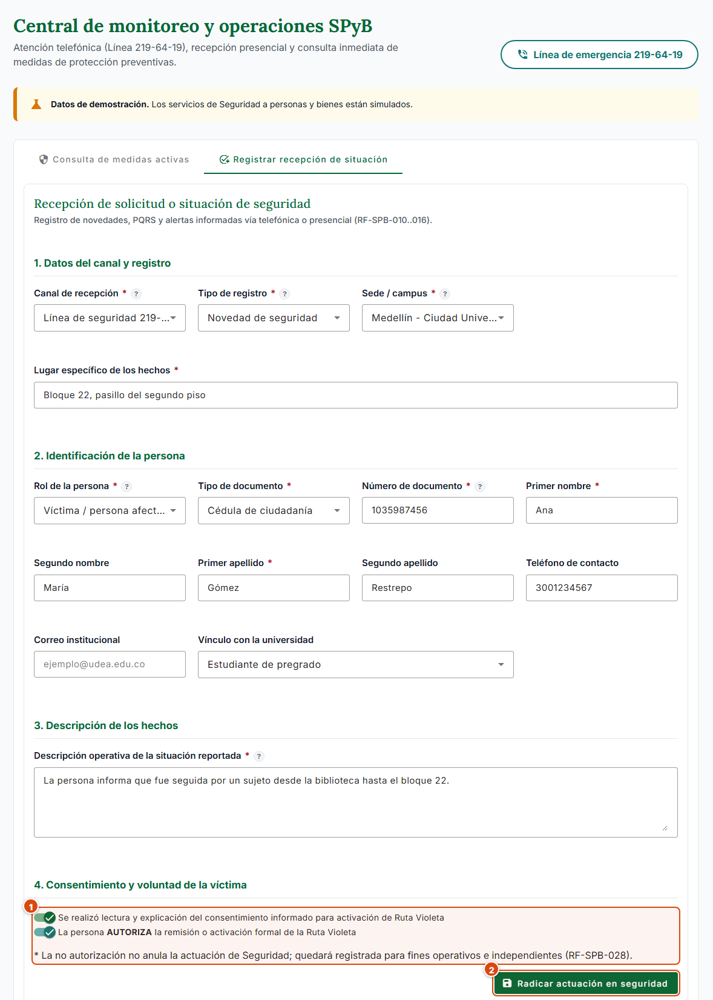

*Captura 15. Sección de consentimiento y botón para radicar.*

| # | Qué hacer |
|:--:|---|
| **1** | Marque los interruptores según lo que la persona respondió. |
| **2** | Pulse **Radicar actuación en seguridad**. Si está deshabilitado, falta algún campo obligatorio o hay un campo en rojo. |

Al terminar aparece un aviso con el **consecutivo oficial** (`SPB-AAAA-NNNNN`) y el formulario queda vacío. Anote el consecutivo si debe informarlo a la persona: la actuación ya está en la pestaña **Nuevos** de la bandeja del analista.

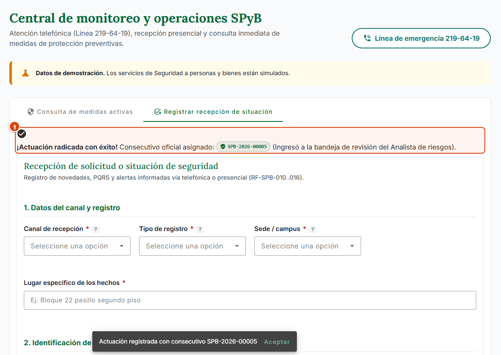

*Captura 16. Aviso de actuación radicada con su consecutivo.*

---

## 9. Reporte de vigilancia

**Menú → Seguridad (SPyB) → Reporte de vigilancia** («Reporte rápido de novedades en ronda»). Es el formulario corto para quien está en campo; compárelo con la Central en la sección 4.

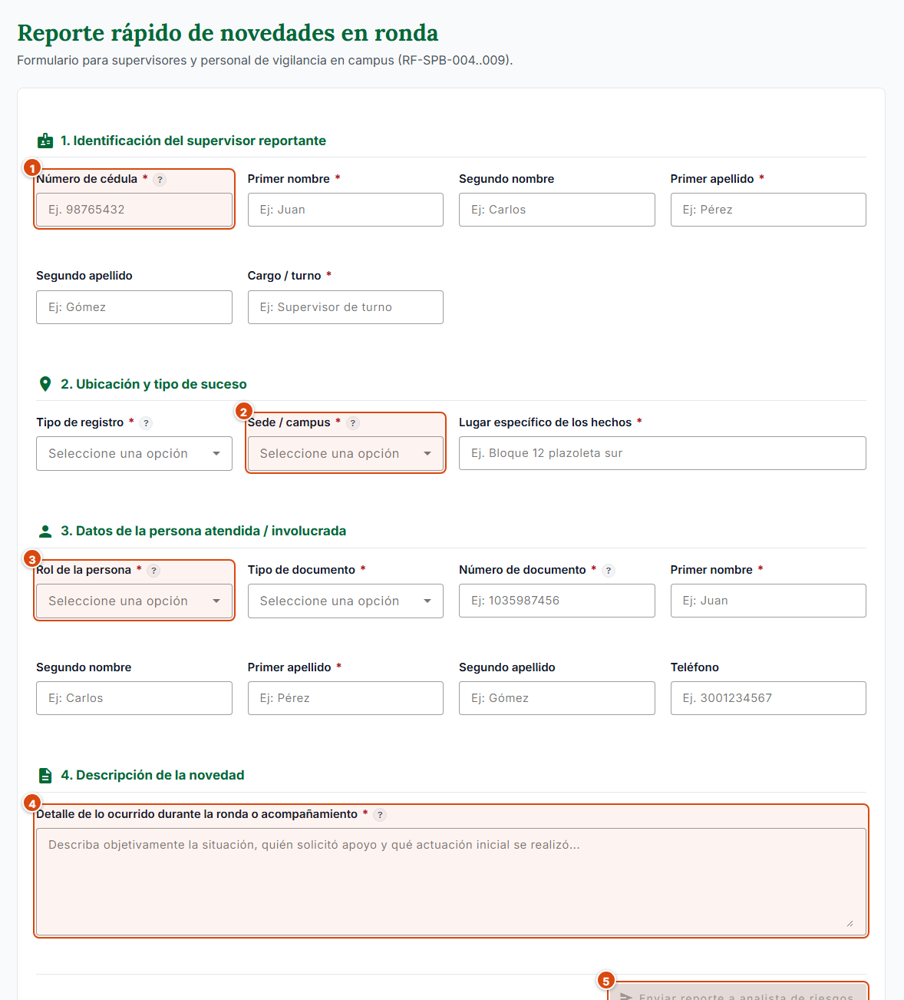

*Captura 17. Formulario de reporte de vigilancia.*

| # | Qué hacer |
|:--:|---|
| **1** | **Sección 1 — Supervisor reportante.** Escriba su cédula (solo números, 5 a 10 dígitos), sus nombres y apellidos y su cargo o turno. Es obligatorio para saber quién reportó. |
| **2** | **Sección 2 — Ubicación.** Elija el tipo de registro y la **sede**, y escriba el lugar exacto. |
| **3** | **Sección 3 — Persona atendida.** Elija su rol, el tipo y número de documento y sus nombres y apellidos. |
| **4** | **Sección 4 — Descripción.** Cuente qué ocurrió, quién pidió apoyo y qué actuación inicial se hizo. |
| **5** | Pulse **Enviar reporte a analista de riesgos**. Verá el consecutivo generado. |

---

## 10. Indicadores SPyB

**Menú → Seguridad (SPyB) → Indicadores SPyB**, o el botón **Tablero de indicadores** de la bandeja. Permite a Coordinación evaluar la oportunidad y efectividad del componente de seguridad.

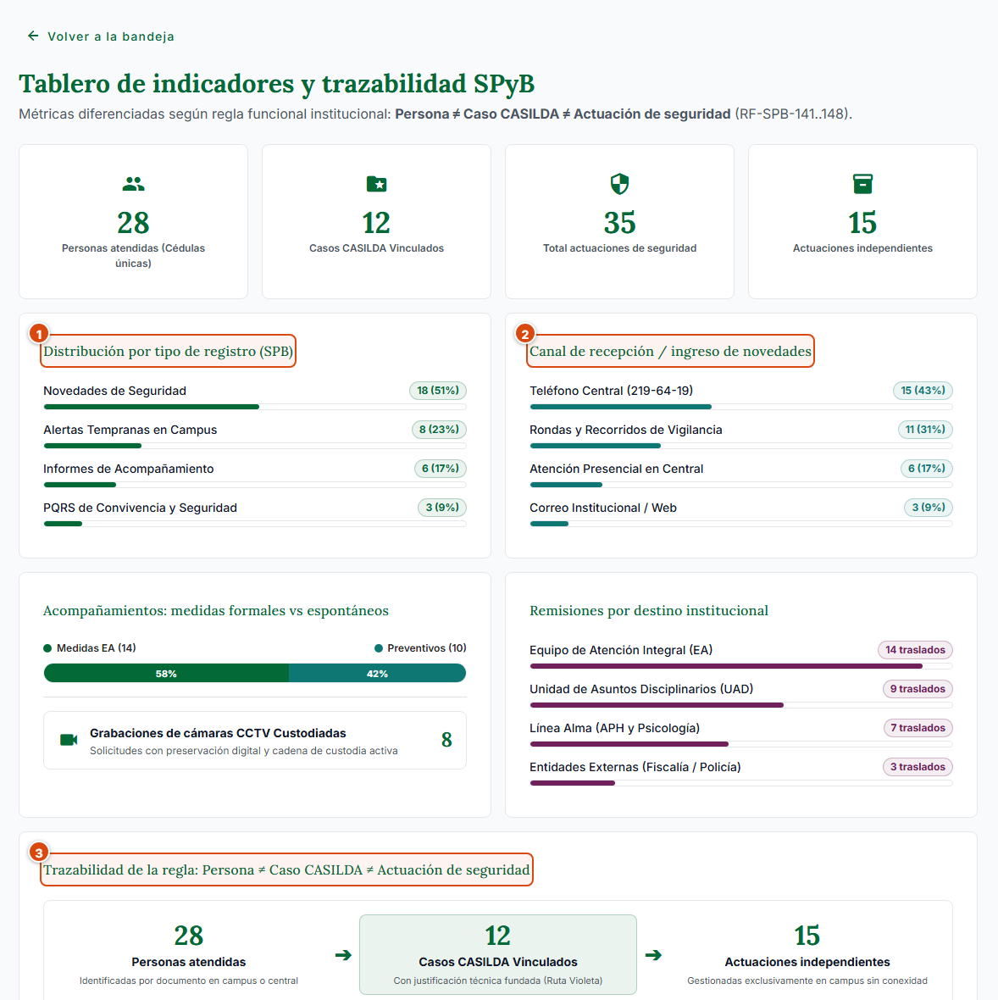

*Captura 18. Tablero de indicadores y trazabilidad.*

| # | Qué ver |
|:--:|---|
| **1** | **Distribución por tipo de registro:** novedades, alertas, PQRS e informes. |
| **2** | **Canal de recepción:** por dónde llegan los reportes. |
| **3** | **Trazabilidad de la regla Persona ≠ Caso ≠ Actuación:** cuántas actuaciones se vincularon a un caso y cuántas se cerraron como independientes. |

---

## 11. Ejecutar una orden de acompañamiento (vigilante)

Esta pantalla **no está en el menú**: el vigilante abre el **enlace seguro** que le envió el analista (o escanea su código QR).

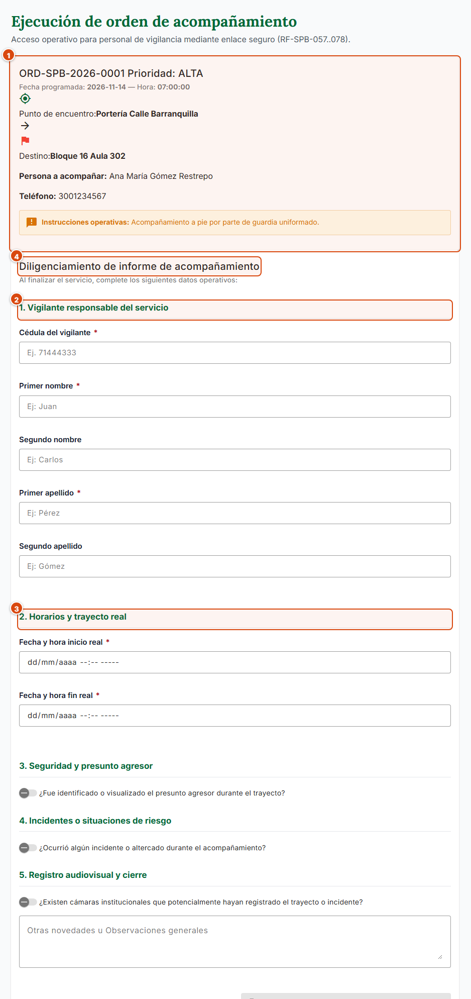

*Captura 19. Pantalla del vigilante para ejecutar una orden.*

| # | Qué hacer |
|:--:|---|
| **1** | Lea la **ficha de la orden**: código, persona, origen, destino, horario y prioridad. Es lo único que verá del caso. |
| **2** | **Sección 1 — Vigilante responsable.** Escriba su cédula y su nombre en campos separados. |
| **3** | **Sección 2 — Horarios y trayecto real:** fecha y hora de inicio y de fin (la de fin posterior a la de inicio, sin fechas futuras). |
| **4** | Complete el informe: seguridad y presunto agresor, incidentes y registro audiovisual. Los detalles se piden solo si marca que ocurrió algo. |

Al terminar, el sistema confirma «Acompañamiento documentado exitosamente» y la orden pasa a *Finalizada* en la bandeja del analista.

---

## 12. Cómo practicar con datos de demostración

Con el servidor simulado activo puede usar estos datos ficticios:

| Dato | Escenario |
|---|---|
| Documento `1035987456` | Persona con medida de protección activa (caso `CAS-2026-0012`). |
| Documento `71234567` | Persona con una ronda preventiva vigente. |
| Actuación `SPB-2026-00001` | Aparece en **Nuevos**; sirve para practicar la vinculación, la subsanación y las órdenes. |
| Actuaciones en **En revisión** y **Pendiente vinculación** | Una de cada una, para ver cada etapa. |
| Órdenes `ORD-SPB-2026-0001` y `…0002` | Aparecen en **Acompañamientos**. |
| Enlace `/seguridad/orden/token-orden-demo-001` | Pantalla del vigilante para ejecutar una orden. |

Para ver todas las pantallas, ingrese con una cuenta con rol **Administrador**. Estos datos existen solo con la configuración de desarrollo y **nunca** se activan en un entorno desplegado. Use **Salida rápida** (botón rojo, `Alt + Q` o doble `Esc`) si necesita cerrar la pantalla de inmediato.
